# Baton

**Pass every task to the right AI.**

Baton is a **personal AI assistant** that does real work. One account belongs to one person. That person's data is kept apart from everyone else's.

Bring your own AI keys, including free ones (Gemini, Groq, OpenRouter, Mistral and more). For every prompt, Baton picks the connected model that is best at that kind of task. If a model hits its limit, Baton hands the work to the next one, the way a relay runner passes the baton.

[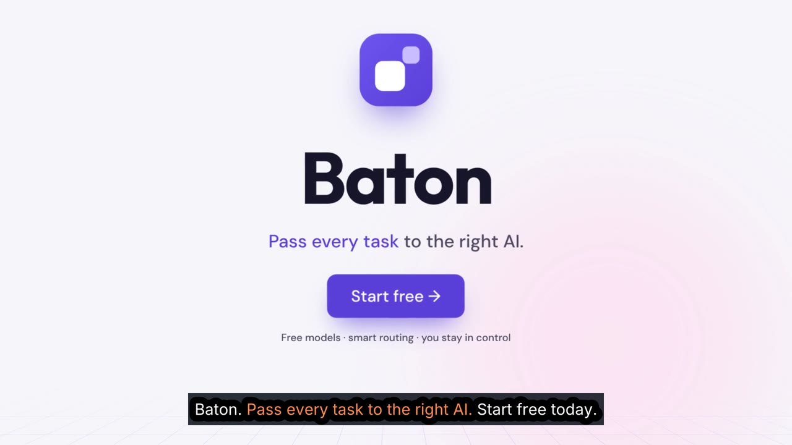](docs/routing-ad.mp4)

[Watch the 48-second launch ad](docs/routing-ad.mp4): free keys, the right model for each prompt, and the hand-off when one hits its limit.

A person who signs in gets:

- a chat assistant that can use real tools, not just talk;
- their own AI keys from any provider, so they pay the provider directly;
- their own connected apps: Google, Microsoft, GitHub, a mailbox, a database, Slack and Teams channels;
- one memory that the assistant and every agent share;
- **agents** they design by chatting, which can run on a schedule;
- approvals, so nothing risky happens until they say yes.

The code lives in a repository and a Docker project that still carry an older working name (`ai-employee-platform`, and a database called `ai_employee`). The product is Baton.

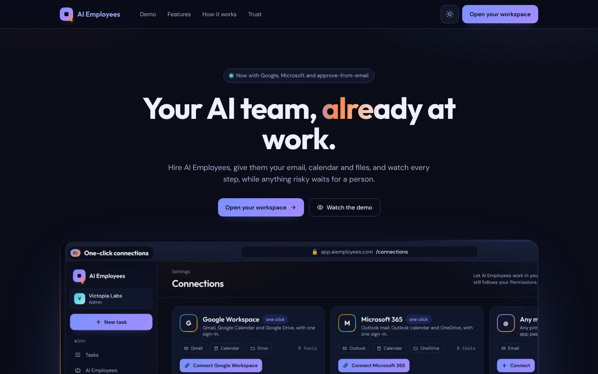

> **Status:** the backend, the worker and the React frontend are built and start with one command. Chat is the home screen. Anyone can create an account at `/register` and sign in with their email or username. A separate Platform Admin console at `/platform` can also create accounts and send one-time setup links.

## What problem this solves

Most AI chat tools stop at advice. They:

- forget everything when the chat closes;
- cannot reach your real apps;
- cannot be trusted with actions that have consequences.

Baton remembers what you tell it, uses your connected apps with your permission, and pauses for your approval before it changes anything.

## How it works

```
You            ->  create an account at /register
You            ->  add one or more AI keys; free tiers like Gemini and Groq are enough
You, in Chat   ->  "Find last week's invoices in Gmail and list them in a sheet."
Baton          ->  picks the connected model that suits the task, passes it on if one is busy
The assistant  ->  plans, uses tools, streams every step live, logs everything
Anything risky ->  pauses and asks you (in the app, by email or in Slack)
Result         ->  the work done, with a full record of each step and its cost
```

## The screens

The menu on the left (you can drag it to the bottom or the right) has these screens. A setup bar at the top shows the first steps until they are done.

| Screen | What it is for |
|---|---|
| **Chat** | The home screen. Talk to the assistant, pick a mode and an AI, and design new agents. |
| **AI Agents** | Four tabs. **Agents**: edit, schedule, run now, pause. **Tree**: a live tree of you, the assistant and your agents, with the scheduler flow. **History**: past runs with filters, run details and replay. **Models and cost**: spend, estimated savings against a reference model, free versus paid. |
| **Approvals** | Actions waiting for your yes or no. |
| **Memory** | What the assistant remembers about you and your work. |
| **Connections** | Your apps, as cards: Google Workspace, Microsoft 365, GitHub, any mailbox (IMAP), PostgreSQL, and Slack and Teams channels through an incoming webhook. |
| **AI keys** | Your AI keys, as cards, with guided setup. Includes free Gemini and Groq, models on your own machine or server, and web search keys (Tavily, Brave). Each key can be marked Free or Paid. |
| **Permissions** | Always allow, Ask me first or Blocked, for every tool. |
| **Notifications** | Where you hear about approvals, finished work and failures. |

The **Platform Admin** console is a separate area at `/platform`. See [Who can do what](#who-can-do-what).

### Command palette and shortcuts

| Keys | What it does |
|---|---|
| **Ctrl+K** | Open the command palette: search every screen and action |
| **N** | New chat |
| **/** | Search the current page |
| **?** | Show all shortcuts |
| **Esc** | Close |
| **G, then a letter** | Go to a screen: **C** Chat, **A** AI Agents, **T** Tree, **H** History, **P** Approvals, **M** Memory, **U** Models and cost, **O** Connections, **K** AI keys, **R** Permissions, **N** Notifications |

Single keys stay quiet while you are typing in a box.

The interface has a violet theme with light and dark modes. The sign-in and sign-up pages share one layout.

## Agentic AI features

What makes this an *agent* rather than a chatbot, in plain words.

### 1. It works in a loop: think, use a tool, check, repeat

The assistant plans a step, calls a tool, reads the result, and decides what to do next, until the job is done. If a tool fails, the error comes back as a sentence ("that file does not exist"), so the assistant can correct itself instead of crashing. Every step is streamed live and kept for replay.

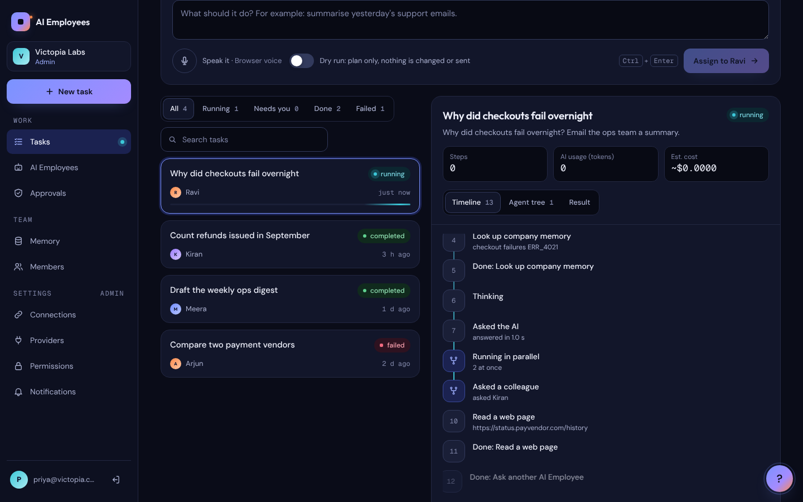

### 2. It uses real tools

There are **58 built-in tools** in these packs:

| Pack | What the assistant can do |
|---|---|
| **Google Workspace** | Search, read, draft and send Gmail, replying in the same thread; archive, label and mark emails; list, create, move and cancel Calendar events (past ones too); search and read Drive files, PDFs included; create, read and write Google Sheets |
| **Microsoft 365** | The same for Outlook mail (archive, flag, categories), Outlook calendar and OneDrive; read, add rows to and update **Excel** workbooks in OneDrive |
| **Slack and Teams** | Post a summary or an alert to one channel, through the incoming webhook you paste in (asks you first) |
| **Any mailbox (IMAP)** | List, read, draft and send email with an app password |
| **GitHub** | Read code, issues, pull requests and CI; comment, open issues, propose changes as pull requests. See feature 14 |
| **Database** | List tables, describe them, and run **read-only** SQL |
| **Web** | Read a public web page or PDF. Search the web with your own Tavily or Brave key, or with the server's key if the server has one. Every redirect is checked, so a page cannot send the request into the private network |
| **Memory** | Remember facts and recall them later |
| **Everyday helpers** | Calculator, current time, text tools, assemble a report, run a short Python program (asks you first) |

### 3. One-click connections, and secrets never reach the AI

Connect Google or Microsoft with one sign-in. When you connect, you choose which parts the assistant may use (for example Gmail and Sheets, but not Drive) and whether it may only read or also edit. Tokens are encrypted with a key tied to your account and refreshed automatically. The AI never sees them: the worker adds the credential only at the moment a tool runs. That is why a prompt-injection attack cannot steal a key: the key was never in the conversation.

If the server has no shared Google or Microsoft sign-in app, you can register your own app and paste its client ID and secret. [How the Google connection works](docs/GOOGLE_CONNECTION.md).

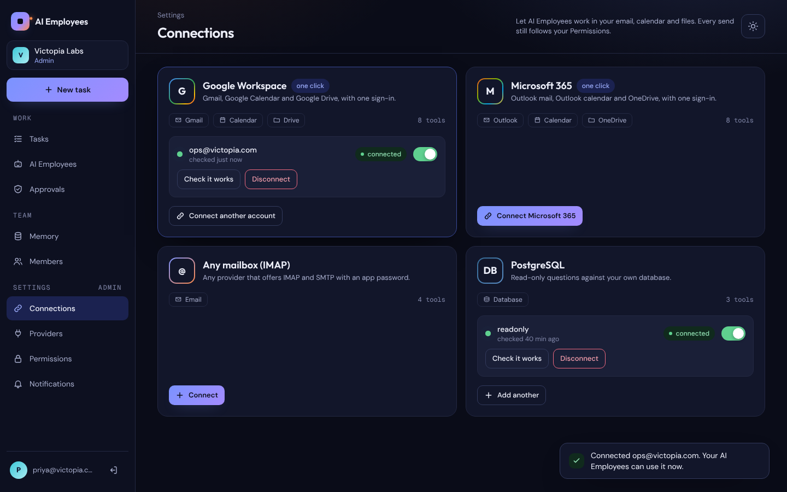

### 4. Always allow, Ask me first, or Blocked: for every tool

Every tool gets one of three settings. You choose it on each connected app (Connections) and on the **Permissions** page.

- **Always allow**: it runs straight away, with **no approval**.
- **Ask me first**: the run pauses until you approve.
- **Blocked**: it never runs.

By default, reading is always allowed and sending asks first. Switching something that cannot be undone (like sending an email) to Always allow asks you once more, in plain words. Agents and team helpers follow the same rules. A tiny list of catastrophic actions (deleting a repository, force-pushing, emailing all contacts) can never be allowed.

A tool runs only when every layer says yes: the platform allows that part of the app, your connection was granted that permission, the agent lists the tool, and your Permissions page allows it.

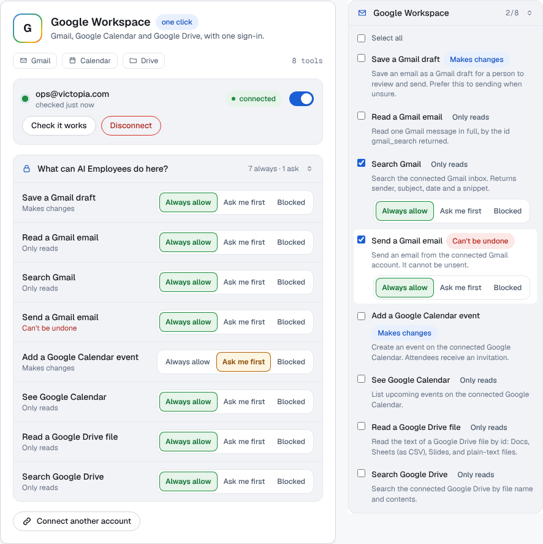

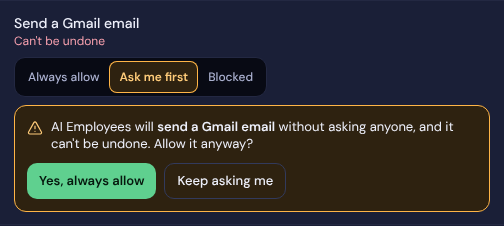

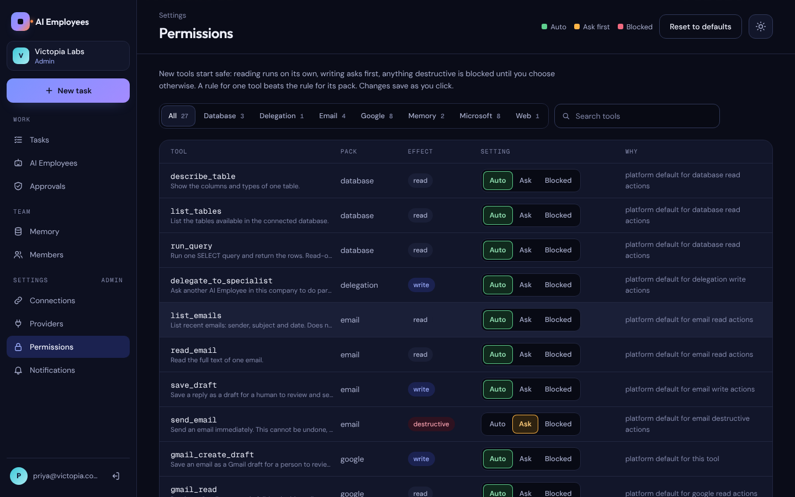

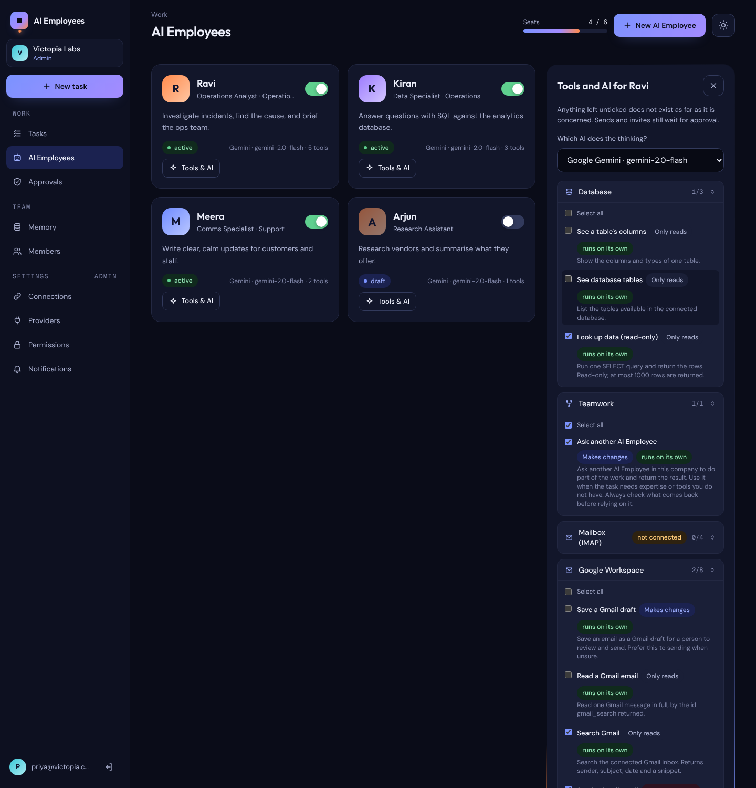

### 5. You approve risky actions, and the run waits

When an action needs approval, the run **pauses** and its conversation so far is saved to the database. The worker moves on to other jobs. When you approve, the run **resumes exactly where it stopped**; a rejection ends it cleanly. Requests expire after 24 hours, so nothing waits for ever. The approval card shows the real action (the full email, say), not a summary.

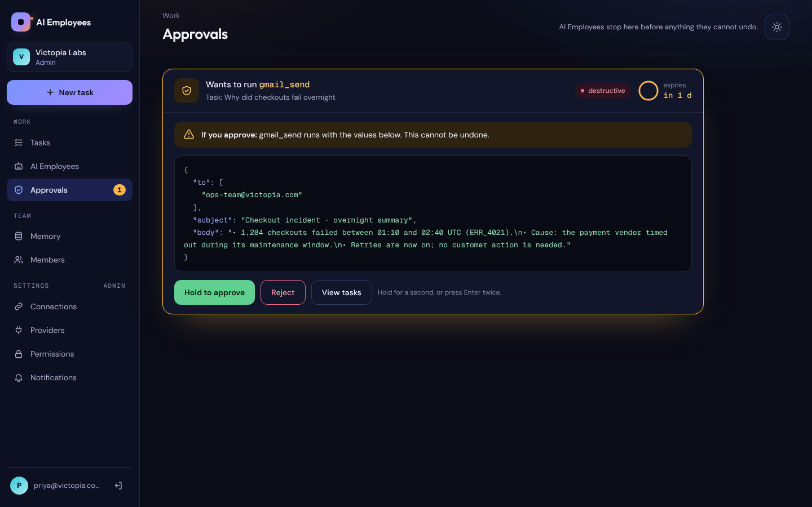

### 6. Approve from your inbox or Slack

You can get an email with your own **Approve / Reject** link, and a Slack channel can get the same message. Opening a link only *shows* the action; nothing is decided until a person presses a button, so a mail scanner that opens links cannot approve anything. Slack links ask whoever clicks to sign in. Email needs SMTP settings on the server.

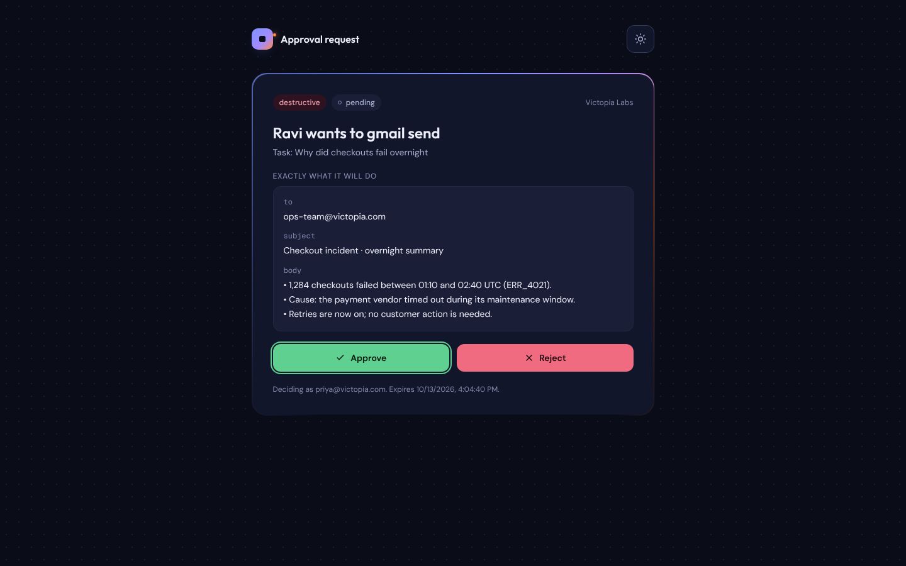

### 7. Agents you design by chatting

An **agent** is a saved helper with a name, instructions, the tools it may use and the AI it prefers. To make one, say in Chat "I want an agent that ...". The assistant asks what it needs, then shows a **draft card** with a readiness check: is each app connected, allowed by the platform, granted by you, and permitted on your Permissions page? **Create** stays off until every check passes. Nothing is saved until you press it, and agents cannot create other agents.

An agent can **run on a schedule** (daily, on weekdays, or on chosen days, at a time in your time zone). Before each run, the worker checks the links again and tells you if something broke, instead of failing all night. Each agent's runs are written into a conversation of its own, so you read the results like any chat. The **AI Agents** page is where you schedule, run now, pause, edit, and see each agent's tree, history and cost. You can have up to 30 agents. More in the [Agents plan](docs/AGENTS_PLAN.md).

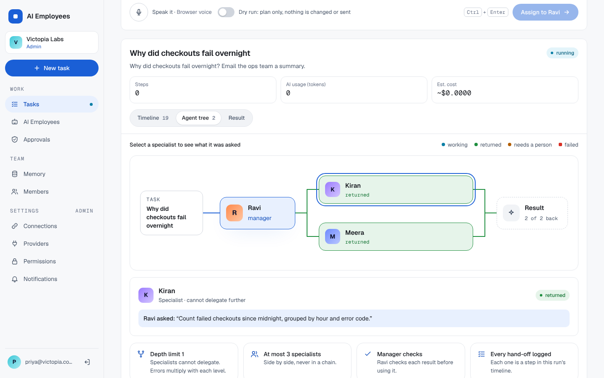

### 8. It does independent steps at the same time

When the model asks for several independent tool calls, up to three run in parallel ("Running in parallel · 2 at once" in the log), so a run finishes sooner.

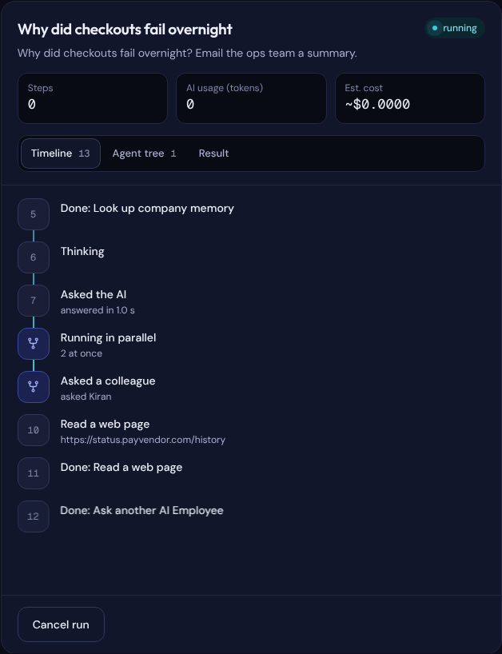

### 9. It remembers you

The assistant can **remember** facts and **recall** them later. Search works **by meaning** (vector embeddings in pgvector) **and by exact words** (full-text search), combined. Embeddings are made on the server by default; you can switch to Gemini, OpenAI or Jina with your own key, which re-embeds your memories. There is one memory per person, shared by the assistant and all your agents. You can read and delete anything on the **Memory** page.

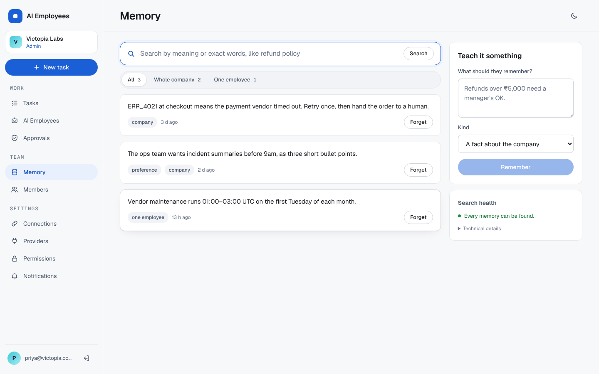

### 10. Seatbelts: budgets and cancel

Every run has caps on steps, tokens and time, so a confused agent cannot loop all night. Any run can be cancelled; the **Cancel** button stays on screen while a run is working. The backend also supports a dry-run flag on a task (plan the work, send and change nothing); Chat does not offer it yet.

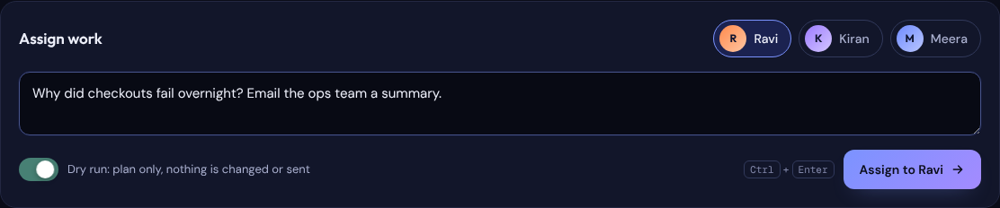

### 11. Every step is on record

Each event (thinking, model call, tool call, result, approval) goes into an append-only log. That one log powers live streaming, reconnecting without losing steps, replay, the agent tree and the record of what happened. Steps, tokens and an estimated cost are shown for every run.

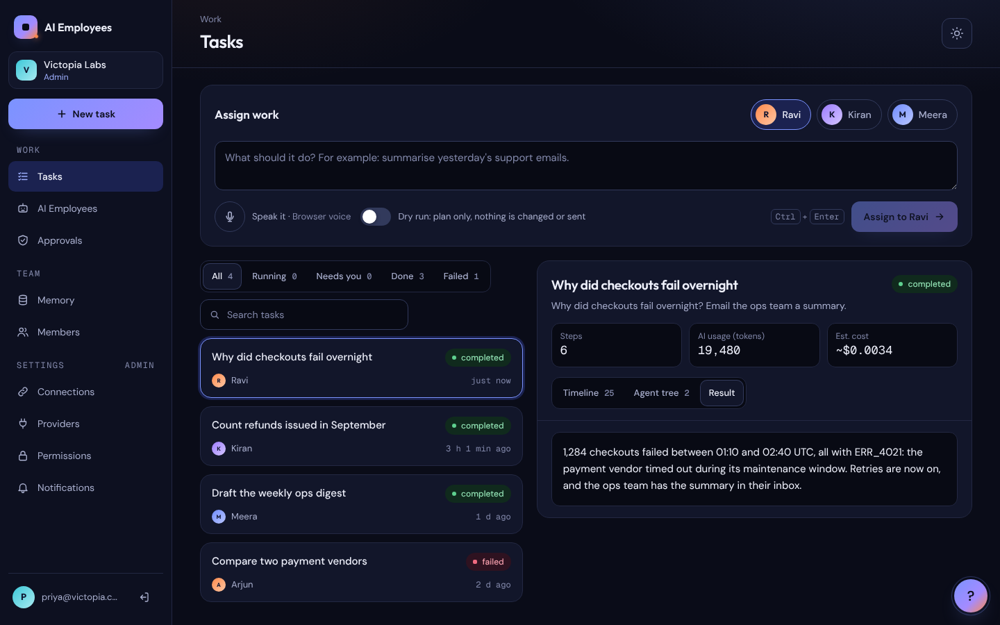

### 12. Any AI provider, with your own key

**AI keys** lists the providers the Platform Admin has turned on: for example Claude (Anthropic), OpenAI (ChatGPT), Gemini, Groq, DeepSeek, Mistral, OpenRouter, Together, NVIDIA and Sarvam. Each one is a card with a short guide to getting a key. You add your own key for each one you want, so the bill stays with you. Gemini and Groq have free tiers.

**Your own server** connects any open-source model (Llama, Qwen, DeepSeek, Mistral, Gemma) running on vLLM, Ollama, LM Studio or LiteLLM: paste the address of its OpenAI-compatible API and the model name. **Load models** asks the provider which models your key can use. Claude uses its own adapter, so its thinking blocks are passed back unchanged between tool calls, as the API requires.

Mark each key **Free** or **Paid**. A call on a free key is counted as costing nothing, and the cost screen shows how much you saved by using free keys. Web search keys (Tavily, Brave) are added the same way.

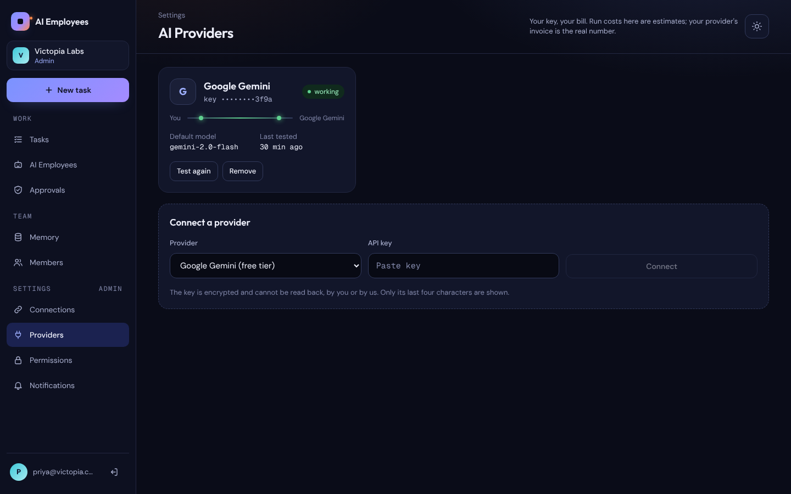

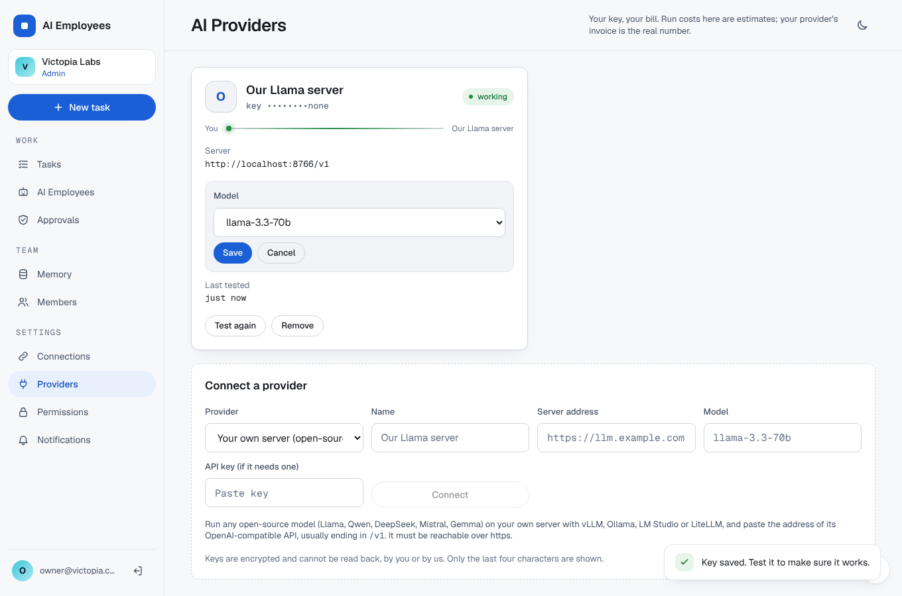

### 13. Chat modes, and switching AI mid-conversation

A **mode** tells the assistant who you are, so you do not re-explain yourself every message:

| Mode | For | How it answers |
|---|---|---|
| **General** | Everyone | Clear and direct |
| **Study** | Students | Explains step by step with an example, checks understanding, gives hints before full homework answers |
| **Work** | Professionals | Concise and ready to use: drafts, decisions, next steps |
| **Research** | Researchers | Summary, findings, open questions; separates fact from inference; never invents citations |
| **Code** | Developers | A careful pair programmer: reads before it suggests, keeps changes small, flags edge cases and tests |

Pick the **AI** under the message box and switch it at any time: history is plain text, so a conversation started on Gemini carries on with Claude or your own Llama, and every reply says which model wrote it. There is no tool list to manage in Chat: every built-in tool is on, and an app's tools switch on once you connect that app. Your Permissions still decide each call. Each answer shows what it used.

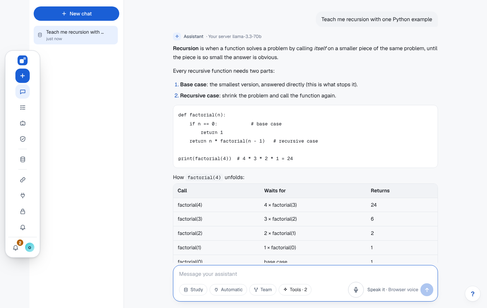

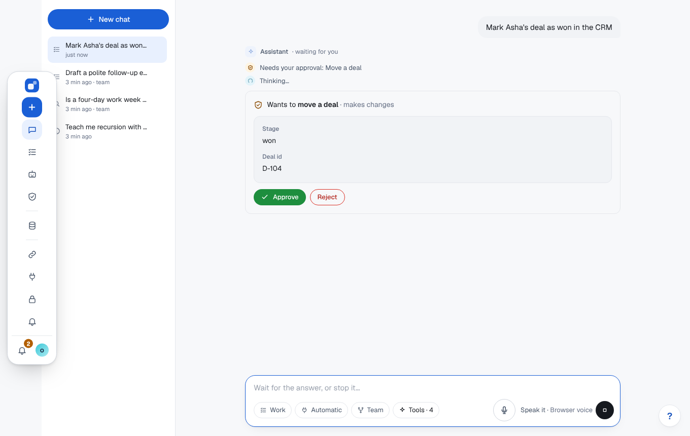

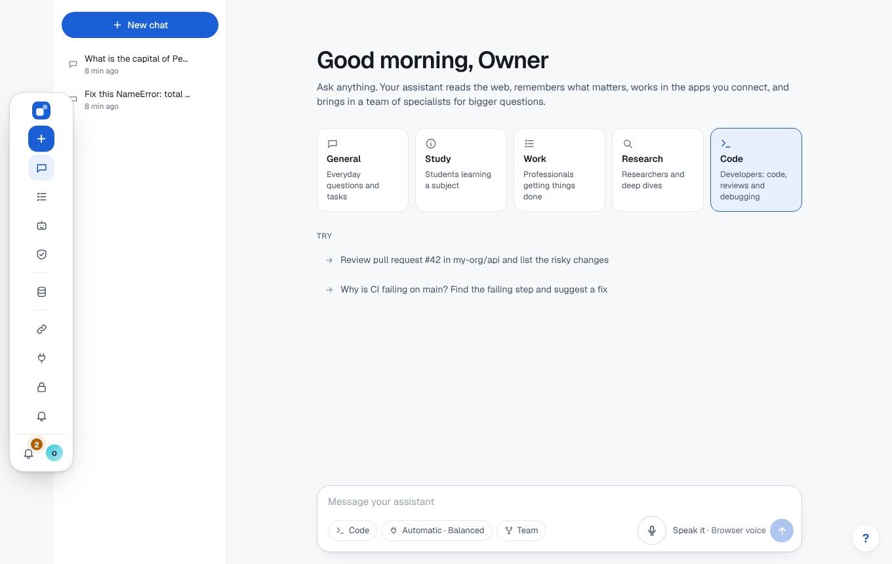

### 14. For developers: GitHub tools

Connect **GitHub** with a fine-grained personal access token, limited to the repositories you choose, and the assistant and your agents get 11 developer tools:

| Reads (run on their own) | Changes (ask you first) |
|---|---|
| See repositories · Search code · Read a file or folder · See issues and pull requests · Read an issue or PR with its comments · **Review a PR's diff** · See recent commits · **Check CI**: which job and step failed | Comment on an issue or PR · Open an issue · **Propose a code change**: new branch, files written, pull request opened |

The rule is simple: **the default branch is never written.** A change always arrives as a pull request for a person to review and merge. There is no merge tool, and deleting a repository or force-pushing are blocked platform-wide.

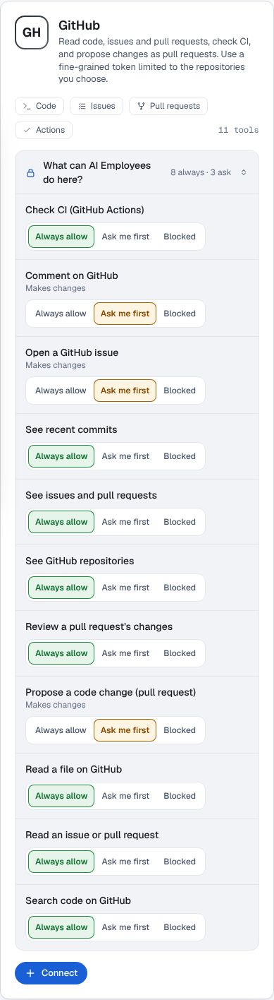

### 15. Team mode: a lead and helpers

Switch on **Team** in a chat and the assistant becomes a lead with helpers: a **researcher**, an **analyst**, a **writer**, a **critic**, a **developer** and a **generalist**. For a big question the lead hands independent parts to several helpers in the same step, so they **work at the same time**, then checks and combines their answers. You can watch each helper start and finish live.

The limits are deliberate: helpers cannot start their own chains, can only **read**, follow your Permissions, see only the task they were given, and get a small step budget. There are at most six helper calls per message, and their cost is counted in the message's cost. A helper that could not finish is tried once more on your strongest AI. Team mode is for chats; scheduled agent runs work alone.

*Off by default (`AGENT_SUPERVISOR`):* a supervisor that first picks which helpers a request needs, and a writer-and-critic review loop for reports (at most two rounds). It has not been tried with a real model.

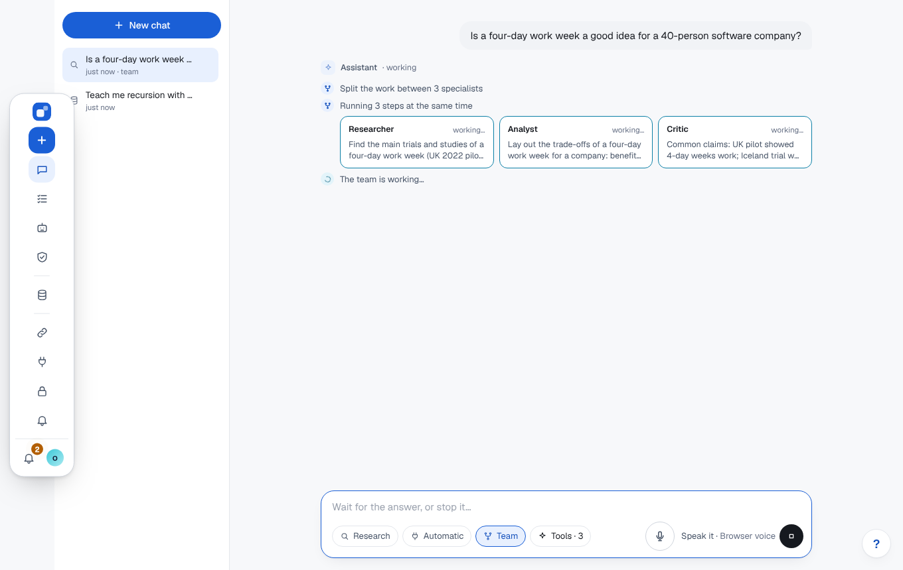

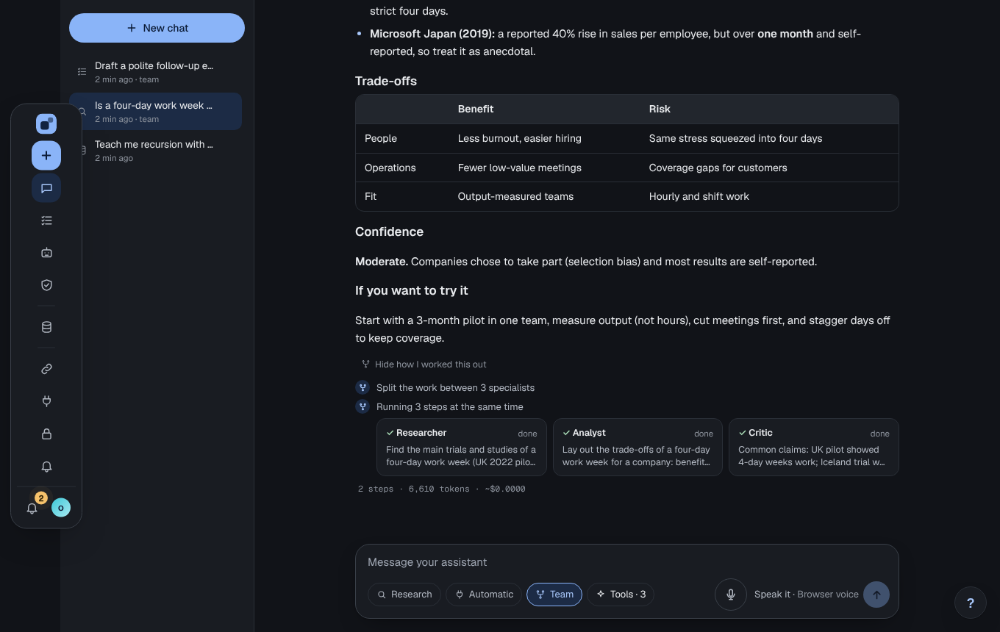

### 16. Connect several AIs; each task goes to the one that suits it

With the AI set to **Automatic**, every task (a chat message, an agent run, each team helper) goes to the connected AI that fits it best:

1. **What kind of task is it?** Fast rules decide most cases for free: code or an error message is coding, a long paste is a long document, "draft an email" is writing. Only when the rules cannot tell is your cheapest AI asked, in one tiny call.
2. **Which AI is best at it?** Each model has a small profile (skill per kind of task, speed, cost). Your preference decides the trade-off: **Balanced** (the default), **Best quality**, **Lowest cost**, or **Private only** (your own server, so nothing leaves it).
3. **If it's busy, the next one takes over.** Your other connected AIs are kept as fallbacks, so a rate limit or an outage at one vendor does not fail the run.

Every answer says which AI wrote it and why. You can still pin one AI in a chat or an agent.

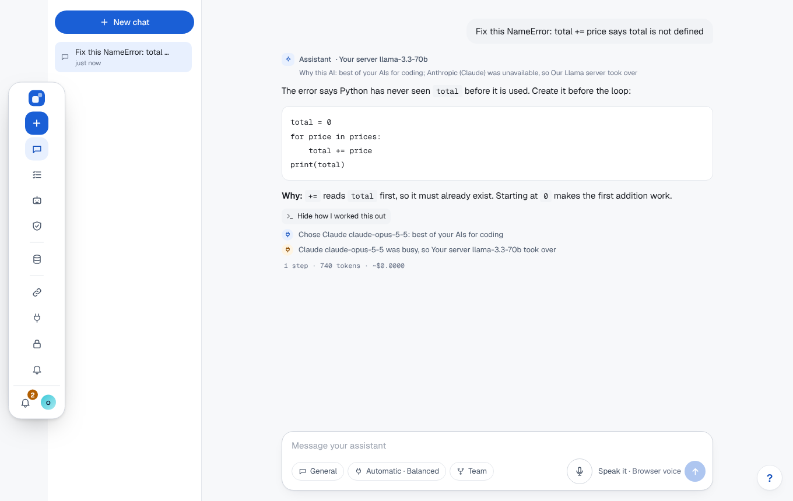

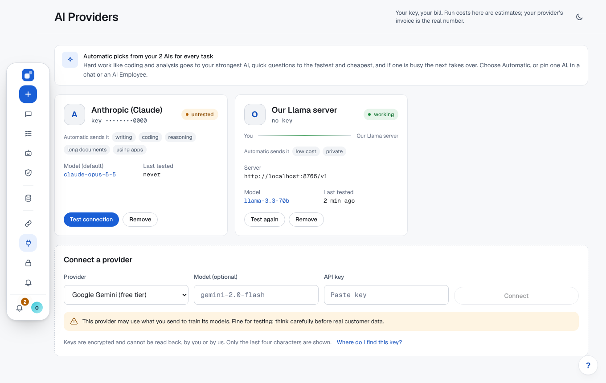

### 17. You hear about it where you work

Email or Slack messages when an approval is needed, when work fails, or when it finishes. Each can be turned on or off on the **Notifications** page.

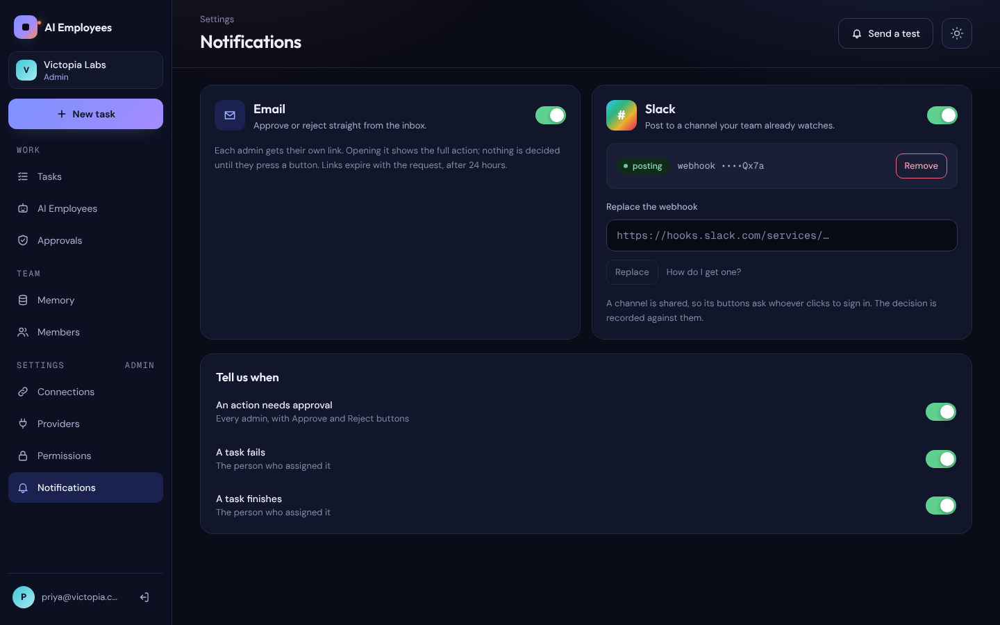

### 18. Speak instead of typing

Press the mic, say what you need, press it again: the words appear in the message box, ready to check before you send. It uses **Whisper Large v3 Turbo** through **your own Groq key**. Without a Groq key you get the browser's built-in voice typing instead. Recordings are never stored, and approvals stay button-only on purpose: voice can ask, but never approve.

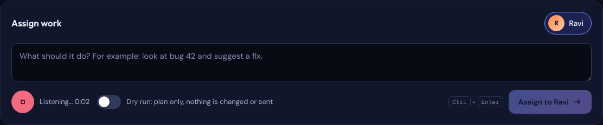

### 19. A welcome tour, and tips when you need them

New people get a short animated welcome, then a spotlight tour of each screen the first time they open it. Tips for a feature appear the first time it shows up. Phones skip what is tucked in the menu. The **?** button replays any tour, and tips can be turned off.

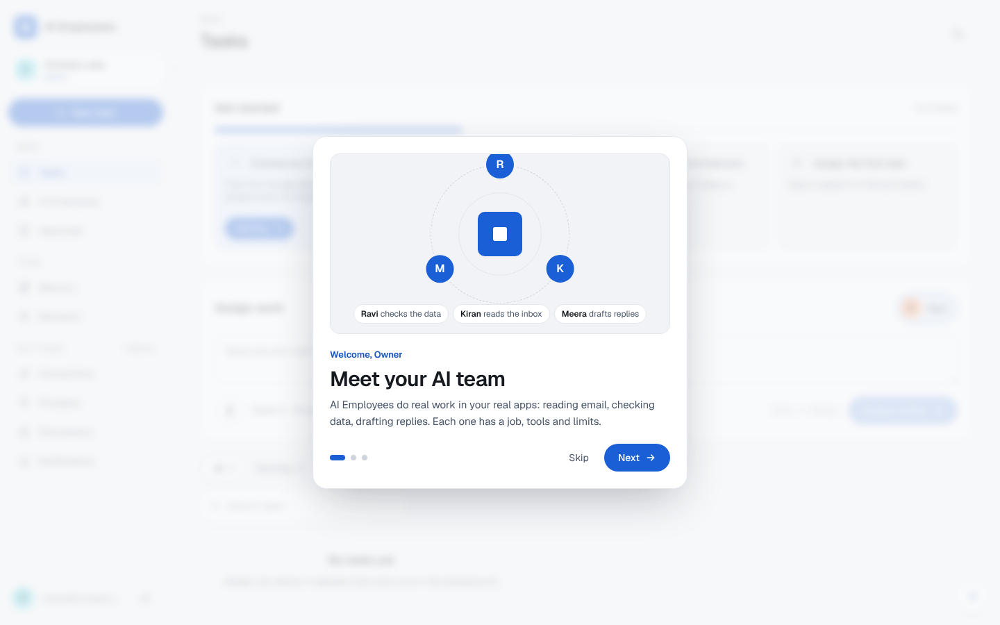

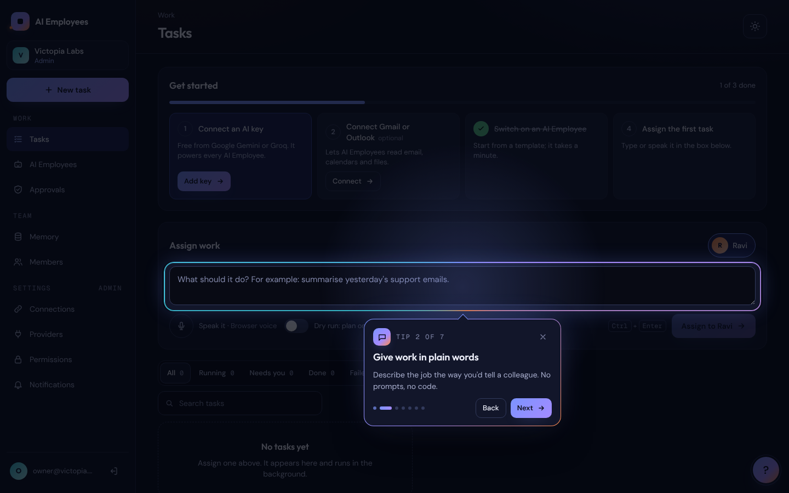

## Who can do what

There are two kinds of account, and they are kept fully apart.

| | **You** (a normal account) | **Platform Admin** (staff) |
|---|---|---|
| Signs in at | `/login`, with email or username | `/platform`, with email and password, and a different kind of token |
| Session | Short-lived access token plus a 30-day refresh cookie | One session cookie that lasts 8 hours or until the browser closes |
| Uses Chat, agents, memory, connections, keys, permissions, approvals | Yes, your own only | No |
| Creates an account | Yes, your own, at `/register` | Yes, for anyone, with a one-time setup link |
| Suspends or restores an account | No | Yes (nothing is read or deleted) |
| Sets up the shared Google and Microsoft sign-in apps | No (you may add your own app instead) | Yes |
| Opens or closes a kind of app, or a part of an app (for example Sheets edit), for everyone or one account | No | Yes |
| Manages the AI provider catalog | No | Yes |
| Reads anyone's chats, memory, tasks, keys or tokens | n/a | **Never**: no endpoint returns them |

What the Platform Admin can see about an account: email, name, active or not, when it was made, how many tasks it has run, and which AI providers it has connected (yes or no, never the key). Every Platform Admin action is written to an append-only audit log that the application cannot edit or delete.

## Stack

| Layer | Technology |
|---|---|
| Frontend | React 18 · TypeScript · Tailwind CSS · Vite |
| Backend | Python 3.12 · FastAPI · SQLAlchemy 2.0 (async) · Alembic |
| Agent runtime | A hand-written agent loop, run inside a LangGraph graph |
| Database | PostgreSQL 16 + pgvector |
| Queue | Redis + arq workers |
| AI | Claude · OpenAI · Gemini · Groq · DeepSeek · Mistral · OpenRouter · Together · NVIDIA · Sarvam · any OpenAI-compatible server (you bring your own key) |
| Tools | 58 built-in tools in packs (Google, Microsoft, GitHub, mailbox, database, web, memory, helpers) |
| Deployment | Docker Compose |

## Architecture

Six containers start with `docker compose up`:

| Container | Job |
|---|---|
| `web` | The React/Vite frontend, on port 5173 |
| `api` | FastAPI on port 8000. Answers requests, writes to the database, queues jobs, streams events (SSE). It never runs an agent. |
| `worker` | arq worker. Runs the agent loop, calls the AI providers and tools, starts scheduled agents, expires old approvals. It serves no HTTP. |
| `postgres` | PostgreSQL with pgvector. The source of truth. Host port **5433**. |
| `redis` | Job queue, live event fan-out, and the shared sign-in and sign-up limits. Host port **6380**. |
| `migrate` | Runs `alembic upgrade head` once, then exits. `api` and `worker` wait for it. |

The ports 5433 and 6380 are not the defaults, so the containers do not clash with a database already installed on your machine.

The full design is in the [High Level Design](docs/HLD.md) and the [Low Level Design](docs/LLD.md).

## Key design decisions

| Decision | Why |
|---|---|
| **Every table that holds a person's data has `owner_id`** | Filtering happens in one repository layer, and a test fails if a new table leaves the column out. One person can never read another's data by a forgotten filter. |
| **You bring your own AI key** | You pay your provider directly; nobody can run up another person's bill. |
| **Tools declare a side-effect label** (read / write / destructive) | Permissions and approvals can be enforced, not just suggested. |
| **Append-only event log per run** | Live streaming, reconnect-safe, replayable, auditable, all from one property. |
| **Credentials never enter the model context** | Prompt injection cannot leak a key that was never there. |
| **Helpers are one level deep; agents cannot create agents** | Errors multiply with every hop; a bounded tree stays debuggable and cannot spawn a swarm. |
| **The Platform Admin cannot read anyone's content or keys** | The endpoint does not exist, so it cannot be misused. |

## Security model

- **Sessions.** The refresh token is an HttpOnly cookie. The access token (15 minutes) lives only in the page's memory. Nothing is stored in `localStorage`. Refresh tokens rotate on use, and reusing an old one revokes the whole family.
- **Staff sessions.** The Platform Admin console uses a different token type that a normal token cannot satisfy. It is kept in a session cookie for 8 hours and is accepted only together with a header that a cross-site page cannot add.
- **Sign-in and sign-up limits.** 10 sign-ups an hour per address. 8 wrong passwords lock that account and address for 15 minutes. Both are counted in Redis, so every API instance shares them.
- **Isolation.** The `owner_id` comes from the signed-in token, never from the request. Another person's item returns 404. A test fails if a table lacks `owner_id`.
- **Secrets.** Keys and tokens are encrypted at rest (AES-GCM, a key derived for each account). They are write-only: no endpoint returns one, to anyone. They are never in logs, in Redis or in the model's context.
- **Passwords.** Hashed with argon2id.
- **Tool output is data.** An email or web page cannot give the assistant orders. Only the allowed tools are described to the model at all.
- **Outgoing addresses.** An address a person types (their own AI server, a webhook) is checked so it cannot point at the server's private network. `ALLOW_PRIVATE_URLS` relaxes this for local development and is refused in production.
- **Audit.** Every Platform Admin action goes to an append-only audit log.

## Documentation

| Document | What it covers |
|---|---|
| [High Level Design](docs/HLD.md) | Who uses it, the running parts, the data model, the main flows, security and scale. |
| [Low Level Design](docs/LLD.md) | Folder layout, tables, the API, the agent loop, tools, permissions, events, encryption, tests. |
| [Agents plan](docs/AGENTS_PLAN.md) | How agents are designed in chat, scheduled and limited. |
| [Google connection](docs/GOOGLE_CONNECTION.md) | What happens when you connect Google, and what can go wrong. |

## Roadmap

| What | Status |
|---|---|
| Foundation, sign-in, AI providers and tools, background runs with live streaming, permissions and approvals, memory, parallel steps and a team of helpers | Built |
| One-click Google and Microsoft, notifications, approve from email or Slack, GitHub | Built |
| Personal accounts, self sign-up with usernames, sign-in with email or username, sign-up and sign-in limits | Built |
| Agents designed in chat, schedules, readiness checks, per-service read and edit permissions | Built |
| Excel in OneDrive, Slack and Teams posting, PDF reading, moving and cancelling events, threaded replies and inbox tidying | Built |
| Setup bar and guided AI-key setup, AI keys as cards, free and paid keys, web search keys | Built |
| AI Agents page: live tree, history with replay, models and cost | Built |
| Command palette and keyboard shortcuts; the violet theme | Built |
| Staff console session that survives a page refresh | Built |
| LangGraph-saved approval pauses (`AGENT_CHECKPOINTER`) and a team supervisor graph (`AGENT_SUPERVISOR`) | Built, off by default |
| Effort-based model choice | Not built |
| Inbound webhooks and mail push notifications | Not built |

## Quick start

You need Docker with Docker Compose.

```bash
docker compose up --build        # starts all six containers
```

The `migrate` container applies the database migrations on its own before `api` and `worker` start. Then open <http://localhost:5173>. The development settings are in `docker-compose.yml`, so no `.env` file is needed to try it.

Other commands (from `Makefile`):

```bash
make up          # same as docker compose up --build
make down        # stop everything
make clean       # stop everything and delete the database volume
make logs        # follow the logs
make migrate     # apply migrations by hand
```

### Your first account

Open <http://localhost:5173/register>, pick a username, enter your email and a password, and you land in **Chat**. Add a key under **AI keys** to start; a free Gemini or Groq key is enough. Later you can sign in at `/login` with either your email or your username.

### Optional: a Platform Admin

A Platform Admin can create accounts for other people and manage platform rules.

1. Create the admin:

   ```bash
   docker compose exec api python -m scripts.bootstrap_admin --email you@example.com
   ```

   It prints a password once if you did not pass `--password`.
2. Open <http://localhost:5173/platform> and sign in.
3. On **People**, enter the person's email (and name, if you like) and press **Create and get setup link**. The link is shown once.
4. The person opens the link (it looks like `http://localhost:5173/login?token=...`) and chooses a password. The link works once and expires after 72 hours.

### Optional services

One-click connections, email notifications and shared web search need settings on the server. Copy `.env.example` to `.env` to set them when you run the backend outside Docker; with Docker Compose, add them to the `environment` section of `api` and `worker` in `docker-compose.yml`. See [Configuration](#configuration).

## Configuration

Settings are read from the environment (and from `.env`) by `backend/app/config.py`. `.env.example` lists them with comments. In production, set real secrets.

| Variable | Meaning | Default |
|---|---|---|
| `ENVIRONMENT` | `dev`, `test` or `prod` | `dev` |
| `DEBUG` | Debug mode | `false` |
| `DATABASE_URL` | PostgreSQL address (asyncpg) | local database |
| `REDIS_URL` | Redis address | `redis://localhost:6379/0` |
| `JWT_SECRET` | Signs tokens. **Required in prod** (the server refuses the dev value) | dev value |
| `ENCRYPTION_KEY` | Master key for secrets at rest. **Required in prod** | dev value |
| `ACCESS_TOKEN_MINUTES` | Access token life | 15 |
| `REFRESH_TOKEN_DAYS` | Refresh cookie life | 30 |
| `PLATFORM_SESSION_HOURS` | Staff console session length | 8 |
| `SETUP_LINK_EXPIRY_HOURS` | How long a setup link works | 72 |
| `PUBLIC_APP_URL`, `PUBLIC_API_URL` | Where people reach the app and API. Used for OAuth redirects and links in messages | localhost addresses |
| `ALLOW_PRIVATE_URLS` | Let a person's own AI server sit on a private address. Development only; refused in prod | `false` |
| `GOOGLE_CLIENT_ID`, `GOOGLE_CLIENT_SECRET` | The shared Google sign-in app | unset |
| `MICROSOFT_CLIENT_ID`, `MICROSOFT_CLIENT_SECRET`, `MICROSOFT_TENANT` | The shared Microsoft sign-in app; `MICROSOFT_TENANT` picks which accounts may sign in (`common` allows work, school and personal) | unset; `common` |
| `TAVILY_API_KEY`, `BRAVE_API_KEY` | A server-wide web search key, used when a person has not added their own | unset |
| `SMTP_HOST`, `SMTP_PORT`, `SMTP_USERNAME`, `SMTP_PASSWORD`, `SMTP_FROM`, `SMTP_USE_SSL` | Outgoing email for notifications. Unset means email is off; Slack still works | unset; port 587 |
| `SLOW_MODE` | Run one job at a time, to stay under free-tier rate limits | `true` |
| `WORKER_MAX_JOBS` | Jobs at once when slow mode is off | 10 |
| `AGENT_SUPERVISOR` | Team mode as a supervisor graph | `false` |
| `AGENT_CHECKPOINTER` | Save approval pauses as LangGraph state in Postgres | `false` |

Database pool settings (`DB_POOL_SIZE`, `DB_MAX_OVERFLOW`, `DB_ECHO`) also exist.

## Third-party services Baton can talk to

Each call uses the person's own credential unless noted.

| Service | Used for |
|---|---|
| AI providers: Anthropic, OpenAI, Google Gemini, Groq, DeepSeek, Mistral, OpenRouter, Together, NVIDIA, Sarvam, or your own OpenAI-compatible server | The assistant's reasoning |
| Gemini, OpenAI or Jina embeddings (optional; the default embedding model runs on the server) | Memory search by meaning |
| Tavily or Brave | Web search (your key first, then the server's key) |
| Google (Gmail, Calendar, Drive, Sheets) through OAuth | Google tools |
| Microsoft (Outlook, Calendar, OneDrive, Excel) through OAuth | Microsoft tools |
| GitHub, with a fine-grained token | GitHub tools |
| Any IMAP and SMTP mailbox, with an app password | Mailbox tools |
| A PostgreSQL database, with a read-only user | Database tools |
| Slack and Microsoft Teams incoming webhooks | Posting to a channel, and Slack approval messages |
| SMTP server (set by whoever runs Baton) | Notification and approval emails |
| Groq Whisper | Voice typing |

## Testing

```bash
make test                  # backend tests on a separate test database (needs the stack's Postgres running)
make lint                  # ruff, ruff format check, mypy strict
make check                 # lint, then tests
cd frontend && npm run lint    # TypeScript check
cd frontend && npm run build   # TypeScript check and production build
```

`make test` creates and migrates a separate database, `ai_employee_test`, and never touches the development database. Tests use scripted and stub providers, so they need no API key and cost nothing.

| Suite | What it checks |
|---|---|
| `backend/tests/unit` | Services, tools, permissions, routing, schedules, the agent loop |
| `backend/tests/integration` | Routes against real Postgres and Redis: sign-up and sign-in, chat, agents, approvals, memory, providers, connections, the Platform Admin |
| `backend/tests/isolation` | Every table that holds a person's data has `owner_id` |

GitHub Actions runs ruff, mypy, a migrate-forward-and-back check and the backend tests on every push to `main` and every pull request.

## Project layout

```
.
├── docker-compose.yml  Makefile  .env.example
├── backend/
│   ├── app/
│   │   ├── main.py          API entrypoint
│   │   ├── config.py        settings
│   │   ├── api/v1/routes/   auth, platform, conversations, agents, tasks, history,
│   │   │                    usage, setup, providers, connections, policies,
│   │   │                    approval_links, memory, notifications, speech, health
│   │   ├── services/        business logic
│   │   ├── db/              models and repositories
│   │   ├── agent/           loop, routing, team helpers, providers, tools/packs
│   │   ├── workers/         worker entrypoint and jobs
│   │   └── core/            security, crypto, rate limits, errors
│   ├── alembic/versions/    migrations 0001 to 0032
│   ├── scripts/             bootstrap_admin.py (creates the first admin)
│   └── tests/               unit, integration, isolation
├── frontend/
│   ├── src/                 App.tsx, pages/, components/, lib/
│   └── scripts/             video and film recorders
└── docs/                    design documents, screenshots and videos
```

## Screenshots and videos

The screenshots and some videos in this README were recorded on an earlier version of the app. They can show old names or an older layout. The functions they show still work as described, but they have not been re-recorded. The launch ad, the feature tour and the live demo were made on the current app (the Google Drive link below still has an older copy of the live demo).

The video scripts that remain in `frontend/` are:

```bash
cd frontend
npm run film             # docs/product-film.mp4, the animated overview
npm run demo:record      # docs/product-demo.mp4, the live demo (needs the app running)
npm run ad:voice-setup   # installs the voice tools the narrated videos need
```

The launch ad and the feature tour have their own scripts in `frontend/scripts/ad-routing/` and `frontend/scripts/feature-tour/`. The screenshot generator and the mock demo server were removed.

[Product videos on Google Drive](https://drive.google.com/file/d/1L8DQJJeDJeSN5XoC2bQ4jBIS5LagYWRL/view?usp=sharing) (an earlier version). The same files are in this repository under `docs/`.

| Video | What it shows | Version |
|---|---|---|
| **[Baton launch ad](docs/routing-ad.mp4)** (0:48) | Free AI keys, each prompt sent to the model that suits it, automatic fallback when one hits a limit, and scheduled agents | Current |
| **[Feature tour](docs/feature-tour.mp4)** (2:14, [subtitles](docs/feature-tour.srt)) | Twelve features on the real app screen with narration: free AI keys and Automatic, chat modes and Team, the 58 tools, connections, agents built by chatting, the Agent Tree, Permissions, approvals, memory, history and cost, voice input and the welcome tour, and the staff console. The screens are screenshots of a demo account; its past runs are seeded data, and the chat answers come from a scripted local test model | Current |
| **[Live demo](docs/product-demo.mp4)** (1:40, [subtitles](docs/product-demo.srt)) | The app in real use: sign up, connect an AI, a chat where the Analyst and Critic help, an agent built by chatting and put on a schedule, the Agent Tree, Permissions and an approval. The replies come from a scripted local test model connected as "Your own server" | Current |
| **[Animated overview](docs/product-film.mp4)** (1:05) | An illustrated tour of the features | Earlier version |
| **[Welcome and tips](docs/coachmarks-demo.mp4)** (0:48) | The first-sign-in welcome, then the spotlight tour | Earlier version |

## Limitations

- **Not load tested.** The design allows more API and worker instances, but only one of each has been run. Postgres has one primary.
- **Free tiers are slow.** One agent task makes many model calls. Slow mode runs one job at a time to stay under free-tier rate limits, so the queue gets longer instead.
- **The Python tool is not a container.** `python_run` runs in a restricted subprocess. It asks for approval and unattended agents cannot use it.
- **No second factor.** Both normal and Platform Admin accounts use a password only. Passwords are hashed, sign-in attempts are limited, and a password reset flow is not built.
- **A shared Google app needs Google's verification.** Gmail scopes are restricted. Until the app is verified, it is limited to a small number of users. Registering your own Google app avoids this. See [Google connection](docs/GOOGLE_CONNECTION.md).
- **Work starts inside the app or from a schedule.** There are no inbound webhooks and no mail push notifications.
- **Cost figures are estimates.** Baton cannot see your provider's invoice.
- **Chat does not offer dry runs yet**, although the backend supports them.
- **The supervisor graph and graph-saved pauses are off by default** and have not been tried with a real model.
- **Voice typing** needs a Groq key. Without one it uses the browser's own speech recognition, which varies by browser.
- **Screenshots and some videos are from an earlier version** (see above).
