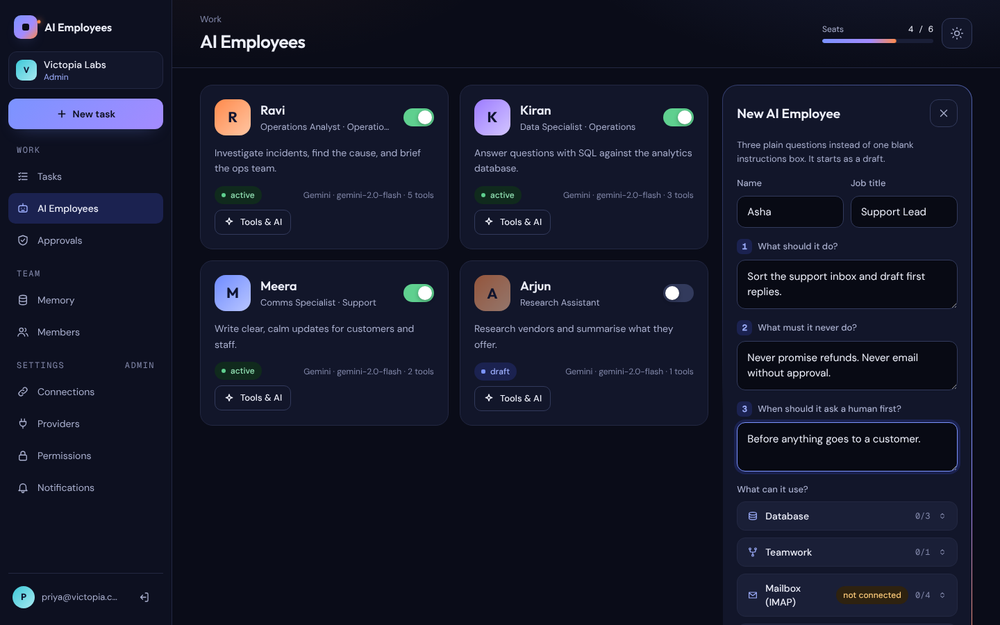

# AI Employee Platform

A platform where business teams (developers, operations, sales, HR) create and manage their own **AI Employees**: AI workers with a role, real tools, memory, and clear limits on what they may do without asking a person.


> **Status:** backend built through Phase 7, plus one-click Google and Microsoft connections and approve-from-email/Slack, and voice typing. 137 tests passing, 74 API operations, 27 agent tools. Full React frontend with dark and light themes.
>
> 🎬 **Videos:** a narrated ad, a live demo and an animated overview are [at the bottom of this page](#-product-videos).

## What problem this solves

Every team has repetitive work that needs real tool access to be useful: triaging incidents, pulling reports, drafting replies. A normal AI chatbot cannot do it, because it:

- forgets everything when the chat closes
- cannot reach your real apps
- cannot be trusted with actions that have consequences

This platform fixes all three.

## How it works

```
Company admin  →  creates an AI Employee (role, three plain answers, tools)
Member         →  assigns a task: "Why did checkouts fail overnight? Email the ops team."
The platform   →  runs it in the background, streams every step live, logs everything
Anything risky →  pauses and asks a person (in the app, by email or in Slack)
Result         →  the work done, with a full audit trail and the cost of the run
```


## Agentic AI features

What makes these AI Employees *agents* rather than chatbots, in plain words.

### 1. It works in a loop: think, use a tool, check, repeat

The AI Employee plans a step, calls a tool, reads the result, and decides what to do next, until the task is done. If a tool fails, the error comes back as a sentence ("that file does not exist"), so the agent can correct itself instead of crashing. Every step is streamed live and kept for replay.


### 2. It uses real tools: 27 of them, in 7 packs

| Pack | What the AI Employee can do |
|---|---|
| **Google Workspace** | Search, read, draft and send Gmail; list and create Calendar events; search and read Drive files |
| **Microsoft 365** | The same for Outlook mail, Outlook calendar and OneDrive |
| **Any mailbox (IMAP)** | List, read, draft and send email with an app password |
| **Database** | List tables, describe them, and run **read-only** SQL |
| **Web** | Read a public web page from the sites a company allows |
| **Memory** | Remember facts and recall them later |
| **Teamwork** | Hand part of the job to another AI Employee |

### 3. One-click connections, and secrets never reach the AI

An admin connects Google or Microsoft with one sign-in. Tokens are encrypted with each company's own key and refreshed automatically. The AI never sees them: the worker attaches the credential only at the moment a tool runs. That's why a prompt-injection attack cannot steal a key: the key was never in the conversation.


### 4. Each AI Employee gets only the tools it needs

A tool that isn't ticked doesn't exist as far as that employee is concerned: it isn't even described to the model. So no clever wording can make it use a tool it wasn't given. A tiny blocklist (deleting a repository, force-pushing, emailing all contacts) can never be enabled at all.


### 5. Permission rules: read freely, ask before acting

Every tool is labelled **read**, **write** or **destructive**. By default, reading runs on its own, writing asks first, and anything destructive asks first or is blocked. Each company can make a rule looser or stricter for a whole pack or for one tool.


### 6. A person approves risky actions, and the run waits

When an action needs approval, the run **pauses** and its whole conversation is saved to the database. The worker moves on to other jobs. When someone approves, the run **resumes exactly where it stopped**; a rejection ends it cleanly. Requests expire after 24 hours, so nothing waits for ever.


### 7. Approve from your inbox or Slack

Admins get an email with their own **Approve / Reject** link, and a Slack channel can get the same message. Opening a link only *shows* the action; nothing is decided until a person presses a button, so a mail scanner that opens links can't approve anything. Slack links ask whoever clicks to sign in, and the decision is recorded against them.


### 8. A manager can delegate to specialists

A manager AI Employee can ask colleagues to do part of the work, and the agent tree shows it live. It's **one level deep on purpose**: errors multiply with every hop, so specialists cannot pass work on again. At most three specialists per run, each with a smaller step budget, and all under the same permission rules.


### 9. It does independent steps at the same time

When the model asks for several independent tool calls, up to three run in parallel ("Running in parallel · 2 at once" in the log), so a run finishes sooner.


### 10. It remembers your company

AI Employees can **remember** facts and **recall** them in later runs. Search works **by meaning** (vector embeddings in pgvector) **and by exact words** (full-text search), combined. Memories can be shared company-wide or kept private to one employee.


### 11. Seatbelts: budgets, cancel and dry run

Every run has caps on steps, tokens and time, so a confused agent cannot loop all night. Any run can be cancelled. **Dry run** mode plans the work but sends and changes nothing.


The **Cancel run** button stays on screen while a run is working (see the parallel-steps screenshot above).

### 12. Every step is on record

Each event (thinking, model call, tool call, result, approval) goes into an append-only log. That one log powers live streaming, reconnecting without losing steps, replay, the agent tree and the audit trail. Steps, tokens and an estimated cost are shown for every run.


### 13. Plain-English setup, and your own AI key

An AI Employee is set up by answering three plain questions: what it should do, what it must never do, and when to ask a person. Those answers become its instructions, and every change is versioned. Each company brings its own model key (**Gemini, Groq, DeepSeek or OpenRouter**), so the bill stays with them and no customer can run up another's costs.




### 14. You hear about it where you work

Email or Slack messages when an approval is needed, when a task fails, or when it finishes. Each event can be turned on or off per company.


### 15. Speak the task instead of typing it

Press the mic, say what you need, press it again: the words appear in the task box, ready to check before you assign. It uses **Whisper Large v3 Turbo** (open source, very good with Indian accents) through the company's own **Groq** key, so it costs the platform nothing. A company without a Groq key gets the browser's built-in voice typing instead. Recordings are never stored, and approvals stay button-only on purpose: voice can ask, but never approve.


---

## Stack

| Layer | Technology |
|---|---|
| Frontend | React · TypeScript · Tailwind CSS |
| Backend | Python · FastAPI · SQLAlchemy 2.0 (async) |
| Database | PostgreSQL + pgvector |
| Queue | Redis + arq workers |
| AI | Gemini · Groq · DeepSeek · OpenRouter (pluggable, BYOK) |
| Deployment | Docker Compose |

## Key design decisions

| Decision | Why |
|---|---|
| **Multi-tenant with `org_id` on every table** | Enforced in one repository layer, plus a test that fails if any table omits it |
| **BYOK** (each company brings their own AI API key) | Zero platform cost per customer; no customer can inflate someone else's bill |
| **Tools declare a side-effect label** (read / write / destructive) | Permission policy and human approval gates are enforceable, not advisory |
| **Append-only event log per run** | Live streaming, reconnect-safe, replayable, auditable, all from one property |
| **Credentials never enter the model context** | Prompt injection cannot leak a key that was never there |
| **Delegation is one level deep** | Error rates multiply with every hop; a bounded tree stays debuggable |
| **Platform Admin cannot read customer data or keys** | The API endpoint does not exist, so it cannot be misused |

## Documentation

| Document | What it covers | Size |
|---|---|---|
| 🏗️ **[High Level Design](docs/HLD.md)** | System context, containers, domain model, core flows, security architecture, scalability, risks. 14 diagrams. | ~970 lines |
| 🔧 **[Low Level Design](docs/LLD.md)** | Folder layout, full database schema, API specification, agent loop, tool and provider contracts, policy engine, SSE protocol, encryption, testing strategy. | ~1,070 lines |
| 📋 **[Implementation Plan](docs/IMPLEMENTATION_PLAN.md)** | Phase-by-phase roadmap in plain English, with decisions, risks and a completion checklist per phase. | ~2,930 lines |

Read them in that order: **HLD → LLD → Plan**.

## Roadmap

| Phase | Name | Status |
|---|---|---|
| 0 | Foundation and walking skeleton | ✅ Built |
| 1 | Auth, companies, Platform Admin with 2FA | ✅ Built |
| 2 | AI Employee configuration and versioning | ✅ Built |
| 3 | LLM providers, tool registry, agent loop | ✅ Built |
| 4 | 🎯 **MVP**: async tasks, worker, live streaming | ✅ Built |
| 5 | Permission policy, approvals, email and SQL tools | ✅ Built |
| 6 | Memory, pluggable embeddings, hybrid search | ✅ Built |
| 7 | Parallel execution, bounded delegation | ✅ Built |
| + | One-click Google / Microsoft, notifications, approve from email or Slack | ✅ Built |
| 8–10 | Reliability · security and cost · production readiness | 🗒️ Outlined, not built |

**Not built, and deliberately so:** the LangGraph migration from Phase 7.
Its dependency footprint was measured at 25 transitive packages to replace a
working loop with a full test suite behind it. What it would add here is
durable checkpointing for pausing inside a branch; the single-path pause
already works and is tested.

## Running it

```bash
docker compose up --build        # all five services
make test                        # 137 tests
make lint                        # ruff + mypy strict
```

Host ports are **5433** (Postgres) and **6380** (Redis), not the defaults, so
the containers do not clash with a database already installed on your machine.

Create the first platform admin:

```bash
cd backend && python -m scripts.bootstrap_admin --email you@example.com
```

One-click connections and email notifications need a few settings (OAuth
client ids, SMTP); they are listed with comments in `.env.example`.

### Screenshots and videos

Everything above is generated from the real app, so it can be refreshed after UI changes:

```bash
cd frontend && npm run build
node scripts/readme-screenshots.mjs   # docs/screenshots/*.png
npm run demo:record                   # docs/product-demo.mp4
npm run ad:voice-setup && npm run ad  # docs/product-ad.mp4 (narrated)
```

## What is verified

| Check | Result |
|---|---|
| Tests | 137 passing: unit, tenant isolation, and integration against real Postgres |
| Types | mypy **strict**, zero errors |
| Lint | ruff with bugbear, bandit, async and blind-except rules |
| Migrations | 8, each verified forward *and* backward |
| Frontend | TypeScript strict build; screens checked in dark, light and phone widths |
| UX audit | Every screen checked as admin and member, on desktop and phone, with the `icp-ux-audit` skill (`.claude/skills/`) |

---

## 🎬 Product videos

▶️ **Watch on Google Drive:** [AI Employees – Product Videos](https://drive.google.com/drive/folders/1UvPBz49-xYwfs9tHebLO8B7bEaPvwV1m)

The same files are in this repository under `docs/`:

| Video | What it shows |
|---|---|
| 🎬 **[Narrated ad](docs/product-ad.mp4)** (1:08) | Six features with title cards, zooms and spotlights, a voiceover in sync with subtitles, and music |
| 🖥️ **[Live demo](docs/product-demo.mp4)** (0:58) | The real app recorded in use, start to finish |
| ✨ **[Animated overview](docs/product-film.mp4)** (1:05) | An illustrated tour of the features |
