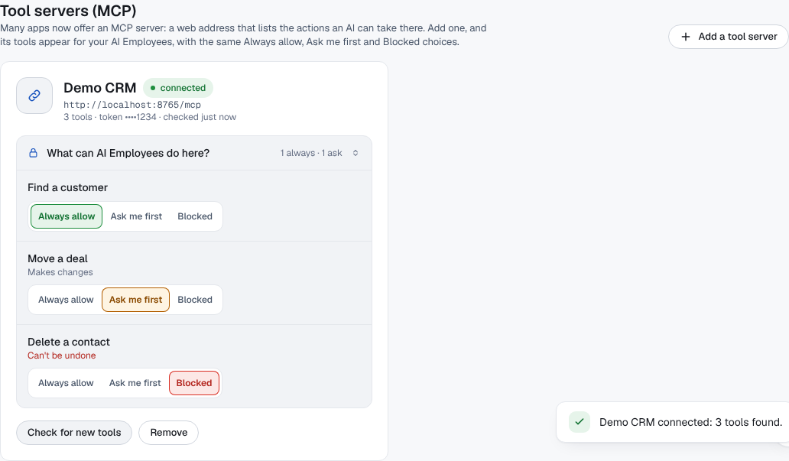

# AI Employee Platform

A platform where business teams (developers, operations, sales, HR) create and manage their own **AI Employees**: AI workers with a role, real tools, memory, and clear limits on what they may do without asking a person.


> **Status:** backend built through Phase 7, plus one-click Google and Microsoft connections and approve-from-email/Slack, voice typing, a guided welcome tour, any AI provider (Claude, ChatGPT, Gemini or your own open-source model server), MCP tool servers, and a personal ChatGPT-style assistant with agent orchestration for students, professionals and researchers. 223 tests passing, 92 API operations, 38 built-in agent tools plus any tools an MCP server offers. Full React frontend with dark and light themes.
>
> 🎬 **Videos:** a narrated ad, a live demo and an animated overview are [at the bottom of this page](#-product-videos).

## What problem this solves

Every team has repetitive work that needs real tool access to be useful: triaging incidents, pulling reports, drafting replies. A normal AI chatbot cannot do it, because it:

- forgets everything when the chat closes
- cannot reach your real apps
- cannot be trusted with actions that have consequences

This platform fixes all three.

## How it works

```
Company admin  →  creates an AI Employee (role, three plain answers, tools)
Member         →  assigns a task: "Why did checkouts fail overnight? Email the ops team."
The platform   →  runs it in the background, streams every step live, logs everything
Anything risky →  pauses and asks a person (in the app, by email or in Slack)
Result         →  the work done, with a full audit trail and the cost of the run
```


## Agentic AI features

What makes these AI Employees *agents* rather than chatbots, in plain words.

### 1. It works in a loop: think, use a tool, check, repeat

The AI Employee plans a step, calls a tool, reads the result, and decides what to do next, until the task is done. If a tool fails, the error comes back as a sentence ("that file does not exist"), so the agent can correct itself instead of crashing. Every step is streamed live and kept for replay.


### 2. It uses real tools: 27 built in, in 7 packs, plus any MCP server

| Pack | What the AI Employee can do |
|---|---|
| **Google Workspace** | Search, read, draft and send Gmail; list and create Calendar events; search and read Drive files |
| **Microsoft 365** | The same for Outlook mail, Outlook calendar and OneDrive |
| **Any mailbox (IMAP)** | List, read, draft and send email with an app password |
| **Database** | List tables, describe them, and run **read-only** SQL |
| **Web** | Read a public web page from the sites a company allows |
| **Memory** | Remember facts and recall them later |
| **Teamwork** | Hand part of the job to another AI Employee |
| **MCP tool servers** | Whatever tools a connected MCP server offers: a CRM, a help desk, an internal API. See feature 17 |

### 3. One-click connections, and secrets never reach the AI

An admin connects Google or Microsoft with one sign-in. Tokens are encrypted with each company's own key and refreshed automatically. The AI never sees them: the worker attaches the credential only at the moment a tool runs. That's why a prompt-injection attack cannot steal a key: the key was never in the conversation.


### 4. Each AI Employee gets only the tools it needs

A tool that isn't ticked doesn't exist as far as that employee is concerned: it isn't even described to the model. So no clever wording can make it use a tool it wasn't given. A tiny blocklist (deleting a repository, force-pushing, emailing all contacts) can never be enabled at all.


### 5. Always allow, Ask me first, or Blocked: for every tool

Every tool gets one of three settings, chosen right where you use it: on each connected app (Connections), next to each ticked tool in an AI Employee's **Tools & AI** panel, and on the Permissions page.

- **Always allow**: it runs straight away, with **no human approval**.
- **Ask me first**: the run pauses until a person approves.
- **Blocked**: it never runs.

By default, reading is always allowed and sending asks first. Switching something that can't be undone (like sending an email) to Always allow asks you once more, in plain words. The rule is company-wide, and specialists that a manager hands work to follow it too. A tiny list of catastrophic actions (deleting a repository, force-pushing, emailing all contacts) can never be allowed.


### 6. A person approves risky actions, and the run waits

When an action needs approval, the run **pauses** and its whole conversation is saved to the database. The worker moves on to other jobs. When someone approves, the run **resumes exactly where it stopped**; a rejection ends it cleanly. Requests expire after 24 hours, so nothing waits for ever.


### 7. Approve from your inbox or Slack

Admins get an email with their own **Approve / Reject** link, and a Slack channel can get the same message. Opening a link only *shows* the action; nothing is decided until a person presses a button, so a mail scanner that opens links can't approve anything. Slack links ask whoever clicks to sign in, and the decision is recorded against them.


### 8. A manager can delegate to specialists

A manager AI Employee can ask colleagues to do part of the work, and the agent tree shows it live. It's **one level deep on purpose**: errors multiply with every hop, so specialists cannot pass work on again. At most three specialists per run, each with a smaller step budget. Specialists follow the same permission rules; a step that needs a person's approval is handed back to the manager, where the normal approval happens.


### 9. It does independent steps at the same time

When the model asks for several independent tool calls, up to three run in parallel ("Running in parallel · 2 at once" in the log), so a run finishes sooner.


### 10. It remembers your company

AI Employees can **remember** facts and **recall** them in later runs. Search works **by meaning** (vector embeddings in pgvector) **and by exact words** (full-text search), combined. Memories can be shared company-wide or kept private to one employee.


### 11. Seatbelts: budgets, cancel and dry run

Every run has caps on steps, tokens and time, so a confused agent cannot loop all night. Any run can be cancelled. **Dry run** mode plans the work but sends and changes nothing.


The **Cancel run** button stays on screen while a run is working (see the parallel-steps screenshot above).

### 12. Every step is on record

Each event (thinking, model call, tool call, result, approval) goes into an append-only log. That one log powers live streaming, reconnecting without losing steps, replay, the agent tree and the audit trail. Steps, tokens and an estimated cost are shown for every run.


### 13. Plain-English setup, and your own AI key

An AI Employee is set up by answering three plain questions: what it should do, what it must never do, and when to ask a person. Those answers become its instructions, and every change is versioned. Each company brings its own model key, so the bill stays with them and no customer can run up another's costs. See feature 18 for the providers.


### 14. You hear about it where you work

Email or Slack messages when an approval is needed, when a task fails, or when it finishes. Each event can be turned on or off per company.


### 15. Speak the task instead of typing it

Press the mic, say what you need, press it again: the words appear in the task box, ready to check before you assign. It uses **Whisper Large v3 Turbo** (open source, very good with Indian accents) through the company's own **Groq** key, so it costs the platform nothing. A company without a Groq key gets the browser's built-in voice typing instead. Recordings are never stored, and approvals stay button-only on purpose: voice can ask, but never approve.


### 16. A welcome tour, and tips exactly when you need them

New people get a short animated welcome, then a spotlight tour of each screen the first time they open it. Tips for a feature appear the first time it shows up (opening an AI Employee's tools, a first run, a first approval). Tips only show what that person can use: members skip admin tips, and phones skip what's tucked in the menu. The **?** button replays any tour, and tips can be turned off.


---

### 17. Connect any MCP tool server, and its tools appear

MCP (Model Context Protocol) is the open standard many apps now ship: a web address that lists the actions an AI can take there. Under **Connections → Tool servers (MCP)**, paste the server's address (and its access token, if it has one). The platform connects straight away, asks the server for its tools, and lists them. Each one gets the same **Always allow / Ask me first / Blocked** choice as a built-in tool. The starting choice comes from the server's own labels: read-only tools run on their own, unlabelled ones ask first, and ones marked destructive start blocked. The token is encrypted and handed to the tool only at call time; the AI never sees it. Every address is checked first, so nobody can point the platform at an internal network address.



Try it locally with the demo CRM server in `backend/scripts/demo_mcp_server.py` (instructions at the top of the file).

### 18. Any AI provider: Claude, ChatGPT, Gemini, or your own open-source model

**AI Providers** offers Claude (Anthropic), OpenAI (ChatGPT), Gemini, Groq, DeepSeek, Mistral and OpenRouter, each with the company's own key. **Your own server** connects any open-source model (Llama, Qwen, DeepSeek, Mistral, Gemma) running on vLLM, Ollama, LM Studio or LiteLLM: paste the address of its OpenAI-compatible API and the model name. Each provider has a model picker: **Load models** asks the provider which models the key can use. Claude uses its own adapter, so its thinking blocks are passed back unchanged between tool calls, as the API requires.


### 19. A personal assistant, ChatGPT-style, that is really an agent

**Chat** is the home page for individual users. It looks like a chat assistant, but every message is answered by the same agent loop as an AI Employee, so it can use your tools, stream its steps live, and pause for your approval before changing anything. A **mode** tells it who you are, so you don't re-explain yourself every message:

| Mode | For | How it answers |
|---|---|---|
| **Study** | Students | Explains step by step with an example, checks understanding, gives hints before full homework answers |
| **Work** | Professionals | Concise and ready to use: drafts, decisions, next steps |
| **Research** | Researchers | Summary, findings, open questions; separates fact from inference; never invents citations |
| **General** | Everyone | Clear and direct |

Pick the **AI** under the message box and switch it at any time: history is plain text, so a conversation started on Gemini carries on with Claude or your own Llama, and every reply says which model wrote it. There is no tool list to manage: **tools are the platform's side, the AI is yours.** Every built-in tool is on, an app's tools switch on once you connect that app, and your MCP servers' tools are on too. Your Permissions still decide each call, so a change waits for your approval right in the chat, and a blocked tool is never offered. Each answer shows what it used.


### 20. Agent orchestration: a lead and a team of specialists

Switch on **Team** and the assistant becomes a lead with four specialists: a **researcher**, an **analyst**, a **writer** and a **critic**. For a big question it plans, hands independent parts to several specialists in the same step so they **work at the same time**, then checks and combines their answers. You can watch each specialist start and finish live, and open "How I worked this out" afterwards.

The limits are deliberate: specialists can't start their own chains (depth 1), can only **read**, never change anything, follow your Permissions, see only the task they were given, and get a small step budget. There are at most six specialist calls per message, and their usage is counted in the turn's cost.


### 21. Connect several AIs; each task goes to the one that suits it

Connect as many AIs as you like with your own keys: Claude, ChatGPT, Gemini, Groq, DeepSeek, Mistral, or your own server. With the AI set to **Automatic**, every task (a chat message, an AI Employee's task, each specialist in a team) goes to the connected AI that fits it best:

1. **What kind of task is it?** Fast rules decide most cases for free: code or an error message is coding, a long paste is a long document, "draft an email" is writing. Only when the rules can't tell is your cheapest AI asked, in one tiny call.
2. **Which AI is best at it?** Each model has a small profile (skill per kind of task, speed, cost). The preference decides the trade-off: **Balanced** (the default: strongest AI for hard work, fast and cheap for easy questions), **Best quality**, **Lowest cost**, or **Private only** (your own server, so nothing leaves it).
3. **If it's busy, the next one takes over.** The other connected AIs are kept as fallbacks, so a rate limit or an outage at one vendor doesn't fail the run.

Every answer says which AI wrote it and why ("best of your AIs for coding"), and the run log shows any handover. In Team mode, each specialist gets the AI best at its role: the researcher one that reads long documents well, the critic the strongest reasoner. You can still pin one AI in a chat or an AI Employee.


### 22. For developers: GitHub tools and a Code mode

Connect **GitHub** with a fine-grained personal access token, limited to the repositories you choose, and the assistant and your AI Employees get 11 developer tools:

| Reads (run on their own) | Changes (ask you first) |
|---|---|
| See repositories · Search code · Read a file or folder · See issues and pull requests · Read an issue or PR with its comments · **Review a PR's diff** · See recent commits · **Check CI**: which job and step failed | Comment on an issue or PR · Open an issue · **Propose a code change**: new branch, files written, pull request opened |

The rule is simple: **the default branch is never written.** A change always arrives as a pull request for a person to review and merge. There is no merge tool, and deleting a repository or force-pushing are blocked platform-wide. The chat's **Code** mode makes the assistant a senior pair programmer: it reads before it suggests, keeps diffs minimal, flags edge cases, tests and security issues, and says what it couldn't verify.


## Stack

| Layer | Technology |
|---|---|
| Frontend | React · TypeScript · Tailwind CSS |
| Backend | Python · FastAPI · SQLAlchemy 2.0 (async) |
| Database | PostgreSQL + pgvector |
| Queue | Redis + arq workers |
| AI | Claude · OpenAI · Gemini · Groq · DeepSeek · Mistral · OpenRouter · any OpenAI-compatible server (BYOK) |
| Tools | Built-in packs + MCP (Model Context Protocol) servers over Streamable HTTP |
| Deployment | Docker Compose |

## Key design decisions

| Decision | Why |
|---|---|
| **Multi-tenant with `org_id` on every table** | Enforced in one repository layer, plus a test that fails if any table omits it |
| **BYOK** (each company brings their own AI API key) | Zero platform cost per customer; no customer can inflate someone else's bill |
| **Tools declare a side-effect label** (read / write / destructive) | Permission policy and human approval gates are enforceable, not advisory |
| **Append-only event log per run** | Live streaming, reconnect-safe, replayable, auditable, all from one property |
| **Credentials never enter the model context** | Prompt injection cannot leak a key that was never there |
| **Delegation is one level deep** | Error rates multiply with every hop; a bounded tree stays debuggable |
| **Platform Admin cannot read customer data or keys** | The API endpoint does not exist, so it cannot be misused |

## Documentation

| Document | What it covers | Size |
|---|---|---|
| 🏗️ **[High Level Design](docs/HLD.md)** | System context, containers, domain model, core flows, security architecture, scalability, risks. 14 diagrams. | ~970 lines |
| 🔧 **[Low Level Design](docs/LLD.md)** | Folder layout, full database schema, API specification, agent loop, tool and provider contracts, policy engine, SSE protocol, encryption, testing strategy. | ~1,070 lines |
| 📋 **[Implementation Plan](docs/IMPLEMENTATION_PLAN.md)** | Phase-by-phase roadmap in plain English, with decisions, risks and a completion checklist per phase. | ~2,930 lines |

Read them in that order: **HLD → LLD → Plan**.

## Roadmap

| Phase | Name | Status |
|---|---|---|
| 0 | Foundation and walking skeleton | ✅ Built |
| 1 | Auth, companies, a separate Platform Admin | ✅ Built |
| 2 | AI Employee configuration and versioning | ✅ Built |
| 3 | LLM providers, tool registry, agent loop | ✅ Built |
| 4 | 🎯 **MVP**: async tasks, worker, live streaming | ✅ Built |
| 5 | Permission policy, approvals, email and SQL tools | ✅ Built |
| 6 | Memory, pluggable embeddings, hybrid search | ✅ Built |
| 7 | Parallel execution, bounded delegation | ✅ Built |
| + | One-click Google / Microsoft, notifications, approve from email or Slack | ✅ Built |
| 8–10 | Reliability · security and cost · production readiness | 🗒️ Outlined, not built |

**Not built, and deliberately so:** the LangGraph migration from Phase 7.
Its dependency footprint was measured at 25 transitive packages to replace a
working loop with a full test suite behind it. What it would add here is
durable checkpointing for pausing inside a branch; the single-path pause
already works and is tested.

## Running it

```bash
docker compose up --build        # all five services
make test                        # 223 tests
make lint                        # ruff + mypy strict
```

Host ports are **5433** (Postgres) and **6380** (Redis), not the defaults, so
the containers do not clash with a database already installed on your machine.

Create the first platform admin:

```bash
cd backend && python -m scripts.bootstrap_admin --email you@example.com
```

One-click connections and email notifications need a few settings (OAuth
client ids, SMTP); they are listed with comments in `.env.example`.

### Screenshots and videos

Everything above is generated from the real app, so it can be refreshed after UI changes:

```bash
cd frontend && npm run build
node scripts/readme-screenshots.mjs   # docs/screenshots/*.png
npm run demo:record                   # docs/product-demo.mp4
npm run ad:voice-setup && npm run ad  # docs/product-ad.mp4 (narrated)
```

## What is verified

| Check | Result |
|---|---|
| Tests | 223 passing: unit, tenant isolation, and integration against real Postgres |
| Types | mypy **strict**, zero errors |
| Lint | ruff with bugbear, bandit, async and blind-except rules |
| Migrations | 16 (the newest, 0016, verified forward *and* backward) |
| Frontend | TypeScript strict build; screens checked in dark, light and phone widths |
| UX audit | Every screen checked as admin and member, on desktop and phone, with the `icp-ux-audit` skill (`.claude/skills/`) |

---

## 🎬 Product videos

▶️ **Watch on Google Drive:** [AI Employees – Product Videos](https://drive.google.com/file/d/1L8DQJJeDJeSN5XoC2bQ4jBIS5LagYWRL/view?usp=sharing)

The same files are in this repository under `docs/`:

| Video | What it shows |
|---|---|
| 🎬 **[Narrated ad](docs/product-ad.mp4)** (1:08) | Six features with title cards, zooms and spotlights, a voiceover in sync with subtitles, and music |
| 🖥️ **[Live demo](docs/product-demo.mp4)** (0:58) | The real app recorded in use, start to finish |
| ✨ **[Animated overview](docs/product-film.mp4)** (1:05) | An illustrated tour of the features |
| 🧭 **[Welcome and tips](docs/coachmarks-demo.mp4)** (0:48) | The first-sign-in welcome, then the spotlight tour gliding across Tasks and AI Employees |
