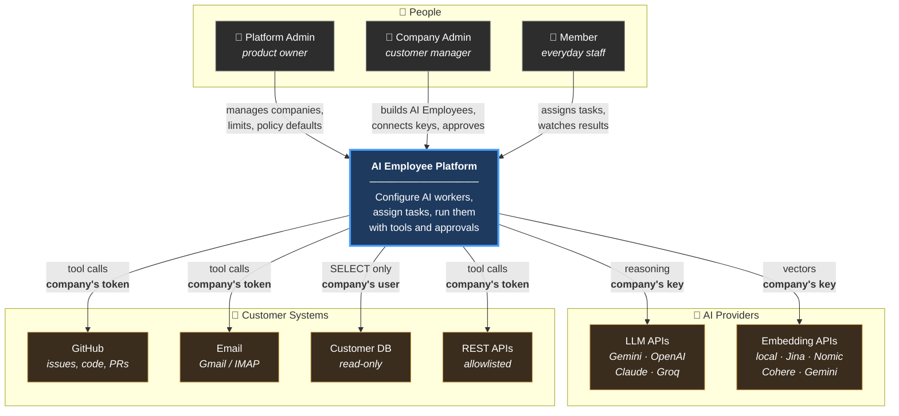
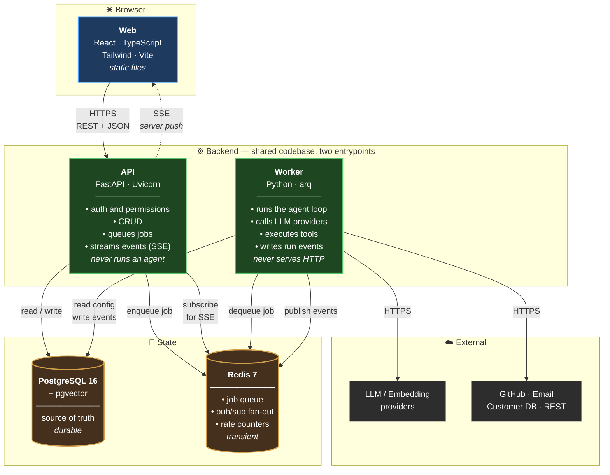
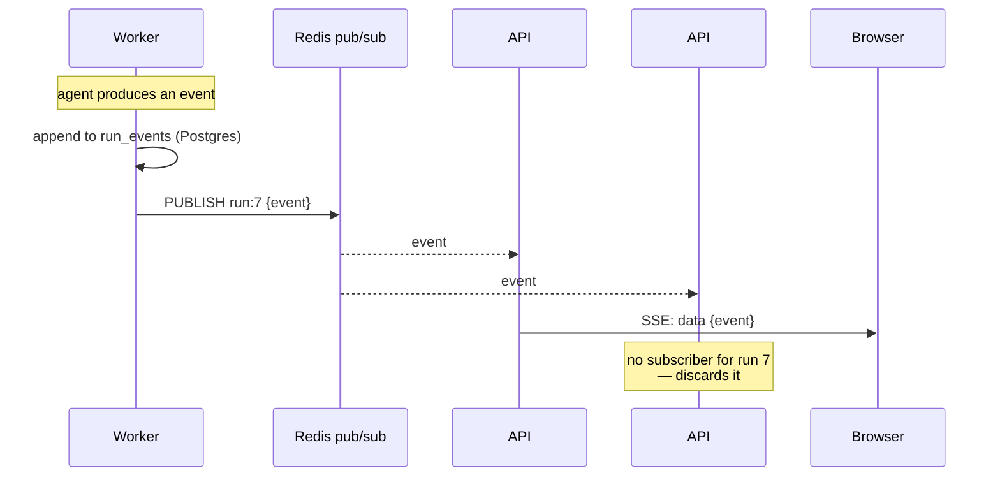
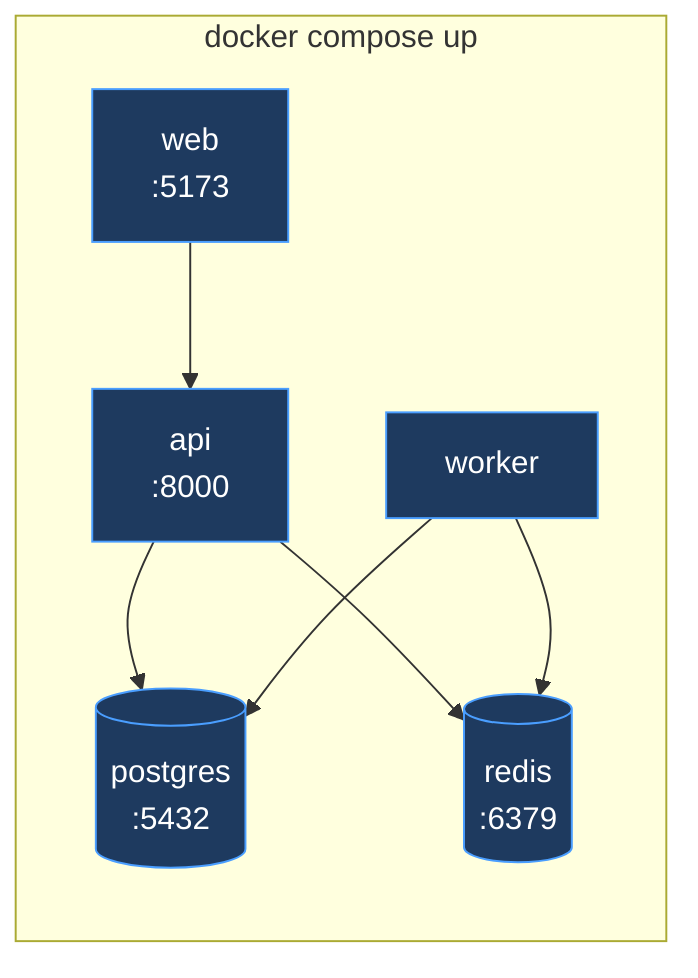
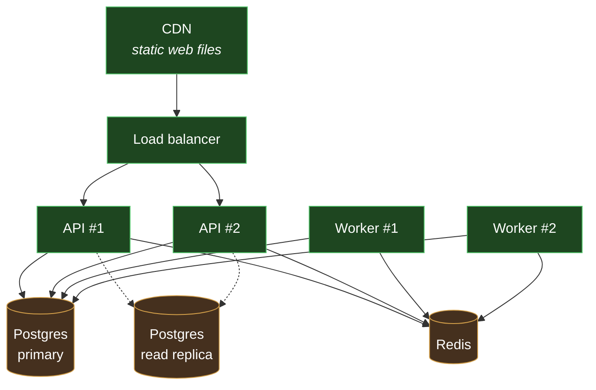

# High Level Design — AI Employee Platform

**Version:** 0.1 (in progress)
**Last updated:** 2026-10-11
**Companion documents:** [Implementation Plan](IMPLEMENTATION_PLAN.md) · [Low Level Design](LLD.md) *(written after this document is agreed)*

## How to read this document

This is the **big picture**: the major pieces, who uses them, and how they talk to each other. It deliberately avoids column names, function signatures and exact API shapes — those live in the [LLD](LLD.md).

Diagrams use Mermaid, which GitHub renders automatically.

> 💡 **All diagrams are Mermaid** — plain text inside this file. To change one, edit the text and GitHub re-renders it. No image files to regenerate, and every change shows up in the git diff.

| Part | Status |
|---|---|
| 1. System context | ✅ |
| 2. Containers | ✅ |
| 3. Domain model | ⬜ |
| 4. Core flows | ⬜ |
| 5. Multi-tenancy and security | ⬜ |
| 6. Scalability and deployment | ⬜ |
| 7. Technology choices, quality targets, risks | ⬜ |

---
---

# Part 1 — System Context

## 1.1 What this system is

A multi-tenant web platform where business teams create and operate **AI Employees**: persistent, configurable AI workers that are given a role, written instructions, a scoped set of tools, and permission boundaries — then assigned tasks they carry out with little or no human involvement.

**In one sentence:** it turns a stateless chat model into a durable, accountable, tool-using worker that a non-programmer can configure and trust.

## 1.2 Why it needs to exist

A general AI chatbot cannot do this work. Three gaps:

| Gap | Consequence |
|---|---|
| **No durable identity** | It forgets everything when the session ends. It cannot learn your conventions. |
| **No tool access** | It can describe how to fix a bug, but cannot read your code or open a pull request. |
| **No accountability** | Nothing records what it did or why, so it cannot be trusted with actions that have consequences. |

This platform closes all three: identity through stored configuration with version history, tools through a registry with permission labels, and accountability through an append-only event log plus human approval gates.

## 1.3 The people who use it

Three distinct actors. Their separation is the backbone of the security model.

| Actor | Who they are | What they do | Boundary |
|---|---|---|---|
| 🔑 **Platform Admin** | The product owner (us) | Creates companies, sets AI Employee limits, curates the provider menu, sets default permission policies, monitors platform health | **Cannot read any customer content, credential or API key.** Not access-controlled — the endpoints do not exist. |
| 👔 **Company Admin** | The customer's manager | Builds AI Employees, connects their own API keys and apps, sets their company's permission policy, approves paused actions | Scoped entirely to their own company |
| 👤 **Member** | Everyday staff | Assigns tasks to existing AI Employees, watches them run, reads results | Cannot change any configuration |

**The guiding principle: Admin builds. Member uses. Platform Admin never looks inside.**

## 1.4 The outside systems it talks to

| System | Direction | Purpose | Whose credential |
|---|---|---|---|
| **LLM providers** — Gemini, OpenAI, Claude, Groq, NVIDIA | Outbound | The reasoning engine for every agent step | The **company's own** (BYOK) |
| **Embedding providers** — local, Jina, Nomic, Cohere, Gemini, OpenAI | Outbound | Converting text to vectors for memory search | The **company's own** (local needs none) |
| **GitHub** | Outbound | The first tool pack: read issues and code, open pull requests | The company's own token |
| **Email** — Gmail / IMAP | Outbound | Read inbox, save drafts, send with approval | The company's own token |
| **Customer databases** — PostgreSQL / MySQL | Outbound | Read-only querying for reporting AI Employees | The company's own read-only user |
| **Arbitrary REST APIs** | Outbound | Generic integration, restricted by an allowlist | The company's own |

### Two context diagram facts worth stating plainly

**1. Every outbound call uses the customer's own credential, never ours.** This is the BYOK decision. It means platform cost per customer is near zero, no customer can inflate another's bill, and we are not a single point of credential failure.

**2. There are no inbound integrations in the MVP.** Webhooks that let an outside system *start* a task arrive in Phase 8. Until then, all work is initiated from inside the platform.

## 1.5 Context diagram



## 1.6 Scope boundaries

Being explicit about what we are *not* building is part of the design, not a gap in it.

### In scope

| Capability | Phase |
|---|---|
| Multi-tenant companies, roles, invite-only accounts | 1 |
| Platform Admin control plane | 1 |
| AI Employee configuration with immutable version history | 2 |
| Pluggable LLM and embedding providers, BYOK | 3, 6 |
| Tool registry with side-effect classification | 3 |
| Asynchronous task execution with live streaming | 4 |
| Append-only run event log, replayable | 4 |
| Measured reliability via an eval harness | 4 |
| Permission policy engine and human approval gates | 5 |
| Three-tier memory with semantic search | 6 |
| Graph workflows: branching, parallelism, bounded delegation | 7 |

### Out of scope

| Not building | Why |
|---|---|
| Billing, subscriptions, payment processing | BYOK means customers pay their providers directly. No money flows through us. |
| Our own LLM or embedding model | We orchestrate models; we do not train them. |
| A visual drag-and-drop workflow editor | One to two weeks of work for presentation value, not capability. Workflows are config. |
| Mobile applications | Responsive web is sufficient for this use case. |
| Real-time human↔AI chat | The interaction model is **task-based**, not conversational. This is a deliberate product choice: a task has a definite goal, a measurable outcome and an audit trail. A chat has none of those. |
| Inbound webhooks | Phase 8. The MVP initiates all work internally. |
| Agents that create other agents | Unpredictable cost and extremely difficult to debug. |

## 1.7 Quality targets

These are the numbers the design must hit. They are referenced again in Part 7.

| Property | Target | Why this number |
|---|---|---|
| **Agent task success** | ≥ 80% on the golden task set | Below this, users must verify every result — which is the work they wanted automated |
| **API response (non-task)** | p95 < 300 ms | Normal CRUD should feel instant |
| **Task acceptance** | p95 < 500 ms | Submitting a task must never block on the agent |
| **Live update delay** | < 1 s from event to screen | Slower than this and the run feels frozen |
| **Company isolation** | **Zero** cross-tenant leaks | Non-negotiable. The single worst failure mode. |
| **Credential exposure** | **Zero** in logs, API responses or model context | Enforced by automated tests, not review |
| **Run reconstructability** | 100% from the event log alone | Required for debugging and audit |

## 1.8 The constraint that shapes everything

**Zero budget. The platform runs on free tiers.**

This is not a footnote — it drives real architectural decisions:

| Consequence | Design response |
|---|---|
| Provider rate limits are low, and **one task makes 10–15 model calls** | Queue-based execution is mandatory, not optional. Concurrency capped at 1 in slow mode. |
| Free tiers may train on submitted data | Providers carry a `trains_on_data` flag; customers are warned explicitly before use |
| No budget for paid embedding APIs | Local embedding model is the default; paid APIs are opt-in |
| No budget for managed monitoring | Observability is built in, not bought (Phase 9) |
| Test runs cost money and quota | Record/replay cassettes make the test suite free and deterministic |

> Worth noting: the rate-limit constraint pushed us toward queue-based async execution — which is the correct architecture for long-running agent work regardless of budget. The constraint improved the design.

---

---
---

# Part 2 — Containers

A **container** here means one independently running process. There are five.

## 2.1 The five containers

| # | Container | Technology | Job | How it scales |
|---|---|---|---|---|
| 1 | **Web** | React · TypeScript · Tailwind · Vite | The screens the user clicks | Static files — behind a CDN, scales free |
| 2 | **API** | FastAPI · Uvicorn (async) | Answers requests, writes to the database, queues jobs, streams events | Horizontally — add instances behind a load balancer |
| 3 | **Worker** | Python · arq | Runs the agent loop: calls the LLM, executes tools | Horizontally — add workers to run more tasks at once |
| 4 | **Database** | PostgreSQL 16 + pgvector | The single source of truth | Vertically first, then read replicas |
| 5 | **Cache / Queue** | Redis 7 | Job queue, event fan-out, rate-limit counters | Vertically; Redis Cluster much later |

## 2.2 Container diagram



## 2.3 The most important decision: API and Worker are separate

This is the architectural choice everything else follows from.

### Why they must be separate

| Reason | Detail |
|---|---|
| **Duration mismatch** | An HTTP request should finish in milliseconds. An agent task takes 1–3 minutes. Putting the agent in the request path means timeouts, frozen screens and lost work. |
| **Independent scaling** | A thousand users browsing need more API instances. Ten heavy agent tasks need more workers. These are different pressures and should be solved separately. |
| **Failure isolation** | A worker crashing mid-task must not take down the website. The API stays up; the task is recovered by the heartbeat reaper. |
| **Different resource shape** | The API is short bursts of CPU. The worker is long periods of waiting on network I/O. |
| **Deployability** | We can restart the API to ship a UI fix without killing tasks that are mid-run. |

### But they share one codebase

Two processes, **one repository, one set of models, two entrypoints**:

```
backend/
├── app/
│   ├── main.py          ← API entrypoint     (uvicorn app.main:app)
│   ├── workers/main.py   ← Worker entrypoint  (arq app.workers.main)
│   ├── db/models/        ← shared by both
│   ├── services/         ← shared by both
│   └── agent/            ← used only by the worker
```

**Why shared, not two repos:** the alternative is duplicating the data models, which guarantees they drift apart. One schema change would need two coordinated releases. Not worth it.

### The rule that keeps it clean

> **The API never runs an agent. The worker never serves HTTP.**

If this rule is ever broken, we have lost the benefits above. It is checked in code review and by the fact that `agent/` is only imported from `workers/`.

## 2.4 Redis does two different jobs

Worth separating in your mind, because they have nothing to do with each other.

### Job 1 — the work queue

```
API: "run task #7"  →  [ Redis list ]  →  Worker picks it up
```

Standard producer/consumer. The queue gives us retries, priority, and natural rate limiting — extra tasks simply wait instead of failing.

### Job 2 — event fan-out for live streaming

This one is subtler, and it is the reason Redis is not optional.

**The problem:** the worker generates events. The browser's SSE connection is held by an **API** instance. With more than one API instance, the worker has no idea which one to tell.

```
❌ Without pub/sub:

Worker ──writes event──> Postgres
                              ↑
API #1 (holds the SSE) ──polls?── slow, wasteful
API #2 (holds nothing)
```

**The solution:** the worker publishes to a Redis channel. Every API instance subscribes. Whichever one holds the connection forwards it to the browser.



**Two things this gives us:**

1. **Durability and liveness are separated.** Postgres holds the permanent record; Redis only carries the live notification. If Redis drops a message, nothing is lost — the client reconnects and replays from Postgres by sequence number.
2. **The API stays stateless.** Any instance can serve any stream. No sticky sessions needed.

### Job 3 — rate-limit counters

Shared counters, so provider rate limits are respected across *all* workers rather than per-worker. Short TTLs, so they expire on their own.

## 2.5 What lives where

| Data | Postgres | Redis |
|---|---|---|
| Users, companies, roles | ✅ | — |
| AI Employee config and versions | ✅ | — |
| Tasks, runs, run events | ✅ | — |
| Encrypted credentials | ✅ | ❌ **never** |
| Memory vectors | ✅ | — |
| Approval records | ✅ | — |
| Pending jobs | — | ✅ |
| Live event notifications | — | ✅ |
| Rate-limit counters | — | ✅ |

**The rule: Redis holds nothing we cannot afford to lose.** If Redis is wiped, we lose queued jobs and live connections — annoying, recoverable. We lose no customer data.

> Credentials never touch Redis. Redis is typically unencrypted at rest and often has weaker access controls than the database. There is no reason to put secrets there.

## 2.6 How the containers talk

| From → To | Protocol | Notes |
|---|---|---|
| Browser → API | HTTPS, REST + JSON | Access token in the header; refresh token in an httpOnly cookie |
| API → Browser | **SSE** over HTTPS | One direction only, which is all we need. Resumable by sequence number. |
| API → Postgres | TCP, async SQLAlchemy | Connection pooled |
| API → Redis | TCP | Enqueue and subscribe |
| Worker → Redis | TCP | Dequeue and publish |
| Worker → Postgres | TCP, async SQLAlchemy | Separate pool from the API |
| Worker → External | HTTPS | Always with the **customer's** credential, with timeout and circuit breaker |

**Note there is no API → Worker arrow.** They never call each other directly. All coordination goes through Redis and Postgres. This is what lets either side restart independently.

## 2.7 Deployment shape

### Development — one machine, one command



One command starts everything. This is the Phase 0 deliverable.

### Production — the same five, scaled



**Nothing in the architecture changes between these two pictures** — only the instance count. That is the point of making the API stateless and routing all coordination through Redis and Postgres.

> ⚠️ **Reality check for this project:** on a free tier we will run **one API and one worker**. The read replica and second instances are what the design *permits*, not what we will deploy. Worth being precise about that distinction in an interview rather than overclaiming.

## 2.8 What we deliberately did not do

| Rejected | Why |
|---|---|
| **Microservices** (separate auth service, agent service, tool service) | Five containers is already enough moving parts for a team of one. Microservices trade local complexity for distributed complexity — network failures, versioning, tracing. No benefit at this scale. |
| **Serverless functions** for the agent | Agent runs last minutes and hold state. Most function platforms cap execution time well below that, and cold starts would be paid on every step. |
| **Kafka / RabbitMQ** instead of Redis | Redis already needed for caching and pub/sub. Adding a second broker for queueing we can do in Redis is unnecessary weight. Revisit only if ordering guarantees or replay become requirements. |
| **WebSockets** instead of SSE | We only need server → browser. SSE is simpler, works over plain HTTP, and reconnects natively. WebSocket's second direction would be unused. |
| **Running the agent inside the API** with background tasks | Loses failure isolation and independent scaling, and an API restart would kill running tasks. |

---

*Part 3 — Domain model — to follow.*
